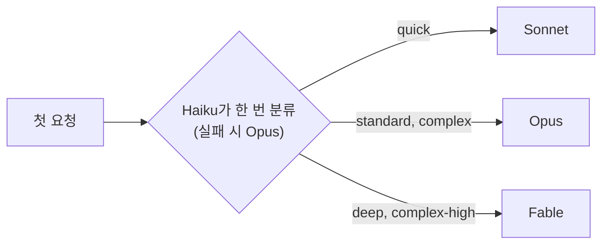
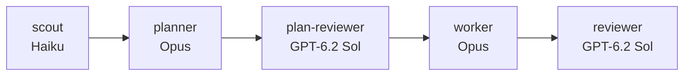

# pi-halfmoon-setup

[English](README.md) | **한국어**

[](https://github.com/halfmoon-mind/pi-halfmoon-setup/actions/workflows/test.yml)
[](LICENSE)

> 첫 요청으로 모델을 고르고, 역할별 에이전트로 작업을 나누는 개인용 [pi](https://pi.dev) 설정 패키지.

여러 머신에서 같은 모델 라우터, 서브에이전트, 워크플로 프롬프트를 씁니다. `router/auto`는 첫 사용자 메시지를 **한 번만** 분류하고 세션 내내 그 티어를 유지해, 모델 전환으로 프롬프트 캐시가 깨지지 않습니다. (예외: 질문만 하는 `quick` 세션은 Sonnet보다 큰 모델이 필요한 메시지가 올 때까지 메시지마다 다시 분류합니다.)





**목차:** [주요 기능](#주요-기능) · [빠른 시작](#빠른-시작) · [사용법](#사용법) · [모델 선택](#모델-선택) · [문제 해결](#문제-해결) · [개발](#개발)

---

## 주요 기능

| 기능 | 설명 |
|---|---|
| **세션 단위 라우팅** | 메인 세션은 Opus, 빠른 질문은 Sonnet, 논리 중심(`deep`)이거나 아주 어려운 작업은 Fable, thinking 레벨도 난이도에 맞춤 |
| **Haiku 분류기** | Claude Haiku가 `claude` 로그인으로 티어와 thinking을 고르고, 실패하면 Opus로 진행 |
| **역할별 서브에이전트** | 탐색·계획·구현·리뷰를 독립된 컨텍스트에서 수행 |
| **워크플로 명령어** | `/implement`, `/scout-and-plan`, `/implement-and-review`, `/deep` |
| **계획 먼저** | 간단한 수정보다 큰 변경은 리뷰를 거친 계획 파일을 만들고, 세션이 얼마나 찼는지에 따라 새 세션이나 worker 서브에이전트에서 구현 |
| **리뷰 게이트** | pi가 멈추기 전에 다른 모델 계열이 프롬프트의 변경을 리뷰하고, 막히는 문제는 다시 돌려보냄 |
| **프롬프트 시간 표시** | 하단 표시줄의 경과 시간, 프롬프트마다의 요약 줄, bash 명령의 평소 소요 시간 ([자세히](#프롬프트-시간-표시)) |
| **Claude CLI 연동** | 로그인된 `claude` CLI를 pi의 모델 프로바이더로 사용 |
| **PDF·Office 읽기** | `read`가 텍스트를 보내고, 이미지가 필요한 페이지·슬라이드만 이미지로 함께 보냄 |
| **샌드박스** | bash는 OS 샌드박스에서 실행되고, pi의 파일 도구도 같은 경로 규칙을 따름 |

## 빠른 시작

**필요:** `pi`와 Claude Code의 `claude`가 PATH에 있어야 합니다. 이 저장소는 독립 실행 앱이 아니라 pi가 로드하는 패키지입니다.

### 1. 설치

```bash
curl -fsSL https://raw.githubusercontent.com/halfmoon-mind/pi-halfmoon-setup/main/setup.sh | bash
# 또는 클론한 저장소에서:
./setup.sh
```

macOS에서는 `setup.sh`가 없는 것만 설치하거나 로그인하므로, 다시 실행해도 바뀌는 것이 없습니다. Linux에서는 `apt-get install poppler-utils pandoc ripgrep bubblewrap socat libreoffice`부터 할 일을 출력만 합니다.

<details>
<summary><code>setup.sh</code>가 하는 일</summary>

- Homebrew로 설치:
  - **poppler** — PDF 읽기
  - **pandoc** — Word 파일
  - **ripgrep** — bash 샌드박스
  - **LibreOffice** — PowerPoint 슬라이드 이미지 (없으면 해당 슬라이드에 들어 있는 그림 원본만 보냄)
- 이 패키지 설치: `pi install git:github.com/halfmoon-mind/pi-halfmoon-setup`
- `claude auth login`과 `pi auth login openai` 실행
- `~/.pi/agent/settings.json`에 아직 없는 [권장 설정](#권장-설정) 키만 추가

</details>

<details>
<summary>로컬 체크아웃 사용</summary>

의존성을 먼저 설치한 뒤 체크아웃을 설치합니다(pi는 로컬 소스의 의존성을 설치하지 않습니다). `setup.sh`보다 먼저 설치하면 `setup.sh`가 `pi list`에서 체크아웃을 찾아 그대로 둡니다. 수정 후에는 pi에서 `/reload`를 실행하세요.

```bash
cd ~/projects/pi-halfmoon-setup && npm ci
pi install ~/projects/pi-halfmoon-setup
```

</details>

### 2. OpenAI 인증

`reviewer`·`plan-reviewer`·`deep-worker` 에이전트와 리뷰 게이트는 `openai` 프로바이더를 씁니다. ChatGPT 구독으로 로그인할 수 있습니다 — `setup.sh`가 `pi auth login openai`로 로그인하며, pi에서 `/login`을 실행해도 됩니다. API 키를 쓰려면:

```bash
export OPENAI_API_KEY="<your-api-key>"
```

### 3. 실행

```bash
pi --model router/auto
```

실행 중에는 `/model`로 `router/auto`를 선택할 수도 있습니다.

시작할 때 이 머신에 없는 것(`claude` CLI나 그 로그인, `openai` 인증, poppler, pandoc, LibreOffice)을 경고하고, 첫 프롬프트 전까지 입력창 위에 워크플로 명령어를 한 줄로 보여 줍니다.

### 권장 설정

머신마다 `~/.pi/agent/settings.json`에 설정합니다(`setup.sh`가 없는 키만 추가). 실행 중인 pi는 다시 시작할 때까지 이전 값을 씁니다.

| 키 | 효과 |
|---|---|
| `"quietStartup": "header"` | pi가 로드한 스킬·확장 목록을 숨김 |
| `"hideThinkingBlock": true` | thinking 블록을 `Ctrl+T`를 누를 때만 펼침. 작업 방향은 tool 호출만 봐도 알 수 있음. 접힌 블록은 `Thinking...` 줄조차 그리지 않음. 설정 전까지 시작할 때 경고가 뜨며, thinking을 계속 보면서 경고만 끄려면 `false` |
| `"steeringMode": "all"` | 큐에 쌓인 steer를 턴마다 하나씩이 아니라 다음 턴에 한꺼번에 전달 |
| `"followUpMode": "all"` | follow-up도 한꺼번에 전달. 단, 여전히 에이전트가 멈추려 할 때까지 기다림 |

접힌 bash 호출은 모델이 작성한 설명이 있으면 그 설명을, 없으면 명령의 첫 줄을 보여 줍니다(세션 디렉터리로 들어가는 맨 앞의 `cd`는 뺌). `Ctrl+O`를 누르면 명령이 작성된 그대로 보입니다.

## 사용법

pi 입력창에서 프롬프트 명령어 뒤에 작업을 적습니다.

```text
/scout-and-plan 로그인 흐름을 조사하고 세션 만료 처리 개선 계획을 세워줘
/implement 설정 파일에 테마 옵션을 추가해줘
/implement-and-review API 응답 파싱 오류를 수정하고 리뷰해줘
/deep 동시 요청에서도 토큰 버킷 rate limiter가 한도를 지키게 해줘
```

| 명령어 | 실행 순서 | 결과 |
|---|---|---|
| `/scout-and-plan` | scout → planner → plan-reviewer | 코드 탐색과 리뷰를 거친 구현 계획. 구현은 하지 않음 |
| `/implement` | scout → planner → plan-reviewer → worker | 탐색, 계획, 계획 리뷰를 거쳐 구현 |
| `/implement-and-review` | worker → reviewer → worker | 구현, 리뷰, Critical 항목 수정 |
| `/deep` | deep-worker (에스컬레이션 시 → worker) | 논리 중심 목표 하나를 GPT-6.2 Sol로 처리하고, 근거로 정할 수 없는 결정은 worker에게 넘김 |

`/scout-and-plan`, `/implement`, `/implement-and-review`는 `subagent` 도구의 `chain` 모드를 쓰고 `{previous}`로 앞 단계의 출력을 넘깁니다. `/deep`은 `deep-worker`를 한 번 호출하고, 출력이 `ESCALATE:`로 시작하면 `worker`를 호출합니다. 도구는 단일 에이전트(`agent` + `task`)와 병렬 실행(`tasks`)도 지원합니다.

접힌 서브에이전트 실행은 에이전트마다 한 줄입니다. 실행 중에는 지금 하는 tool 호출을, 끝나면 답의 첫 줄(실패하면 오류)을, 아직 시작하지 않은 chain 단계는 `waiting`을 보여 줍니다. `Ctrl+O`를 누르면 각 작업, tool 호출, 전체 출력이 보입니다.

### 작업 흐름

- **계획 먼저, 그리고 handoff** — 간단한 수정보다 큰 작업은 먼저 `planner`와 `plan-reviewer`를 거쳐 `docs/plans/<이름>.md`에 계획을 쓰고, `handoff` 도구가 세션이 얼마나 찼는지에 따라 새 세션이나 `worker` 서브에이전트에서 구현하게 합니다.
- **리뷰 게이트** — pi가 멈추기 전에 `reviewer` 에이전트가 프롬프트의 변경을 리뷰하고, `BLOCK`이면 문제를 모델로 다시 돌려보냅니다. `/review-gate on`과 `/review-gate off`로 켜고 끕니다.

자세한 내용은 [작업 흐름](docs/workflow.ko.md)을 보세요.

### 프롬프트 시간 표시

프롬프트가 실행되는 동안 하단 표시줄에 경과 시간이 흐르고, 끝나면 전체 시간, 에이전트 시간, 오래 걸린 도구를 한 줄로 보여 줍니다. bash 명령이 실행되는 동안에는 그 명령이 보통 걸리는 시간을 보여 주고, 그 두 배를 넘기면 모델에게 알립니다.

걸린 시간은 `~/.pi/agent/bash-times.json`에 남기며, 경로나 인자 없이 디렉터리와 명령의 해시, 실행 파일 이름, 최근 10번의 시간만 저장합니다.

### 파일 읽기

- **PDF** — 각 페이지의 텍스트와, 그림이 있거나 텍스트가 없는 페이지만 이미지로.
- **Word·Excel·PowerPoint** — 변경 추적, 댓글, 수식, 차트 숫자, 발표자 노트가 담긴 텍스트와, 이미지가 필요한 슬라이드만 이미지로.

페이지와 슬라이드를 고르는 방식과 측정 결과는 [파일 읽기](docs/file-reading.ko.md)를 보세요.

### 샌드박스

bash는 OS 샌드박스 안에서 실행되어 프로젝트와 임시 디렉터리에만 쓰고, 허용된 호스트에만 접속하며, 목록에 있는 자격 증명 경로는 읽지 못합니다. pi의 파일 도구도 같은 경로 규칙을 따르고, 위험한 몇 가지 동작은 먼저 확인을 받습니다.

규칙, 막힌 접근의 제안, 에스컬레이션, `~/.pi/agent/sandbox.json` 설정, 다루지 않는 것은 [샌드박스](docs/sandbox.ko.md)에 있습니다.

## 모델 선택

`router/auto`는 첫 사용자 메시지를 티어 하나로 분류합니다. `standard`와 `complex`는 같은 분류의 thinking 레벨도 따르고, 나머지 티어는 `medium`을 씁니다.

| 티어 | 모델 |
|---|---|
| `quick` | Sonnet |
| `standard`, `complex` | Opus |
| `deep`, `complex-high` | Fable |

분류할 수 없으면 `complex` 티어의 Opus를 씁니다. 전체 티어 표, 분류기, 데이터셋 로그는 [라우팅](docs/routing.ko.md)에 있습니다.

### 에이전트

| 에이전트 | 모델 | 역할 |
|---|---|---|
| `scout` | `pi-claude-cli/claude-haiku:high` | 코드를 읽고 관련 파일과 핵심 맥락을 정리 |
| `planner` | `pi-claude-cli/claude-opus:high` | 탐색 결과와 요구사항으로 구현 계획 작성 |
| `plan-reviewer` | `openai/gpt-6.2-sol:high` | worker가 실행하기 전에 다른 모델 계열로 계획의 막히는 문제를 고침 |
| `worker` | `pi-claude-cli/claude-opus:high` | 할당된 작업을 구현 |
| `deep-worker` | `openai/gpt-6.2-sol:medium` | 테스트로 확인할 수 있는 논리 중심 목표 하나를 구현하거나 `ESCALATE`로 답함 (oh-my-openagent의 deep-low 레인) |
| `reviewer` | `openai/gpt-6.2-sol:high` | 다른 모델 계열로 코드 품질과 보안 리뷰 |

- Claude 모델명은 pi가 해석하는 부분 이름입니다. 역할과 모델은 [`agents/`](agents/)의 Markdown 파일에서 설정합니다.
- `subagent` 도구가 에이전트 목록과 `description`을 모델에 보여 주므로, 메인 모델이 스스로 위임할 수 있습니다(예: 논리 중심 하위 작업을 `deep-worker`에). 에이전트를 추가한 뒤에는 `/reload`를 실행하세요.

**에이전트 범위:**

| `agentScope` | 로드 대상 | 이름이 겹칠 때 우선 |
|---|---|---|
| `"user"` (기본) | 패키지 에이전트 + `~/.pi/agent/agents/` | 사용자 에이전트 |
| `"both"` | 위 항목 + 프로젝트 `.pi/agents/` | 프로젝트 에이전트 |
| `"project"` | 프로젝트 `.pi/agents/`만 | — |

## 문제 해결

| 증상 | 확인할 사항 |
|---|---|
| 새 세션마다 `classifier unavailable` 경고 | `claude`가 PATH에 있는지, `claude auth login`이 완료됐는지 |
| `pi-claude-cli` 프로바이더 로드 실패 | `claude`가 PATH에 있는지, `claude auth login`이 완료됐는지 |
| `is not in the model catalog` | 선택된 프로바이더가 로드됐는지, pi 모델 카탈로그 |
| `deep-worker`, 리뷰 단계, 리뷰 게이트의 인증 오류 | `openai` 프로바이더 인증과 해당 모델 접근 권한 |
| 프로젝트 에이전트가 선택되지 않음 | `agentScope: "both"` 또는 `"project"`를 쓰는지 |
| PDF를 읽을 때 `pdfinfo not found` | `brew install poppler` 또는 `apt-get install poppler-utils` |
| .docx를 읽을 때 `pandoc not found` | `brew install pandoc` 또는 `apt-get install pandoc` |
| .pptx를 읽을 때 LibreOffice가 슬라이드를 렌더링하지 못했다고 나옴 | `brew install --cask libreoffice`. 설치 전까지 해당 슬라이드에는 그림 원본만 붙음 |

Claude 요청은 `claude -p`로 실행되므로 Claude Code의 사용자 설정, 훅, 플러그인이 영향을 줄 수 있습니다. Claude Code의 MCP 서버와 내장 도구는 웹 검색·가져오기 외에는 쓰지 않습니다. pi의 도구는 MCP 서버를 거쳐 Claude에 전달되고, `claude` 프로세스 하나가 턴 사이에도 대화를 유지합니다. 인증 정보와 머신별 UI 설정은 저장소가 아닌 각 머신의 pi·Claude 설정에서 관리하세요.

## 개발

### 저장소 구조

```text
setup.sh                    패키지에 필요한 것을 확인하고 없는 것만 설치·로그인
agents/                     역할별 프롬프트와 모델 설정
prompts/                    슬래시 명령어용 워크플로 템플릿
extensions/
  router.ts                 router/auto 분류, 티어와 라우팅
  router.test.ts            라우터 테스트
  sandbox/                  bash용 OS 샌드박스와 pi 파일 도구에 쓰는 같은 경로 검사
  footer.ts                 라우팅된 tier와 모델, 세션 ID 앞 13자를 보여 주는 2줄 하단 표시줄
  review-gate.ts            프롬프트마다 변경을 리뷰하는 종료 전 게이트
  handoff.ts                계획 먼저 메모, handoff 도구, /handoff
  checks.ts                 계획 단계 형식: 파싱, 검사, check 명령 실행
  pdf-read.ts               PDF용 read: 페이지 텍스트와 필요한 페이지의 이미지
  office-read.ts            .docx·.xlsx·.pptx용 read: 텍스트와 필요한 곳의 이미지
  tab-follow-up.ts          에이전트 실행 중 Tab으로 후속 질문 대기열에 추가
  timing.ts                 하단 표시줄의 프롬프트 타이머와 프롬프트마다의 시간 요약 줄
  bash-times.ts             timing.ts가 보여 주는 명령별 평소 bash 소요 시간
  compact-tools.ts          read·grep·find·ls·bash 호출을 한 줄로 접어 보여 줌
  startup.ts                시작 경고와 워크플로 명령어 줄
  test-hooks.ts             테스트에서 pi 패키지를 pi와 같은 방식으로 불러오는 설정
  subagent/                 서브에이전트 실행 및 에이전트 탐색
  pi-claude-cli/            Claude CLI 프로바이더
docs/                       참고 문서: 작업 흐름, 라우팅, 파일 읽기, 샌드박스
docs/images/                GitHub 소셜 미리보기 이미지
bench/agent/                에이전트 평가 세트: 모델별 통과율과 거짓 완료율
```

### 테스트

Node.js 22.18 이상과 pi가 설치된 환경에서 저장소 루트를 기준으로 실행합니다.

```bash
npm test
```

<details>
<summary>테스트가 검증하는 것</summary>

- **라우터** — 분류, 폴백, 모델 선택, Haiku 호출 인자와 실패 처리
- **서브에이전트 도구** — 에이전트 로드와 chain 실행
- **리뷰 게이트** — 변경 감지, 판정, 계획 대조
- **handoff** — 세션 신호, 유지/이동 판단과 새 세션 생성, 계획 파일 git 제외
- **PDF 읽기** — 이미지를 붙이는 페이지와 페이지 범위
- **Office 읽기** — Word 변경 추적, Excel 셀과 수식, PowerPoint 차트 숫자·노트·그림
- **Claude CLI 프로바이더** — 시스템 프롬프트 전달, 도구 호출, CLI 오류 처리

pi 패키지는 설치된 pi(`~/.pi/agent/install`)에서 불러오고, `pi`와 `claude` 실행은 가짜 프로세스로 대체합니다. 실제 모델 프로바이더 인증과 전체 워크플로 실행은 별도로 확인해야 합니다.

</details>

GitHub Actions는 main 브랜치 push와 모든 PR마다, 그리고 매주 npm의 최신 pi를 설치해 같은 테스트를 실행합니다. 그래서 pi 업데이트로 이 패키지가 깨지면 바로 드러납니다.

### 평가 세트

`PI_EVAL=1`이면 print 모드(`pi -p`)도 대화형 세션처럼 게이트가 적용됩니다. 계획 먼저 메모, `handoff`(이때는 새 세션으로 옮기지 않음), 계획 check 실행, 리뷰 게이트가 모두 동작합니다. 서브에이전트는 json 모드로 실행되므로 적용되지 않습니다.

`bench/agent/`에는 모델별 통과율과 거짓 완료율을 게이트가 있을 때와 없을 때로 재는 과제 14개가 있습니다.

```bash
node --import ./extensions/test-hooks.ts bench/agent/run.ts --dry
```

`--dry`는 모델을 호출하지 않고 과제 파일만 확인하지만, `test-hooks.ts`로 pi 패키지를 불러오므로 설치된 pi가 필요합니다. 실제 실행은 수동이고 비용이 들며, 게이트 쪽 실행에는 `/review-gate on`이 필요합니다. 자세한 내용은 [`bench/agent/README.md`](bench/agent/README.md)를 보세요.

## 라이선스 및 출처

[MIT](LICENSE). `subagent` 확장은 pi의 예제에서 가져와 패키지 내 에이전트를 로드하도록 수정했습니다. Claude CLI 프로바이더는 `pi-claude-cli` 0.3.1을 가져와 pi 0.99에 맞게 수정한 코드이며, 해당 [MIT 라이선스](extensions/pi-claude-cli/LICENSE)를 포함합니다.
