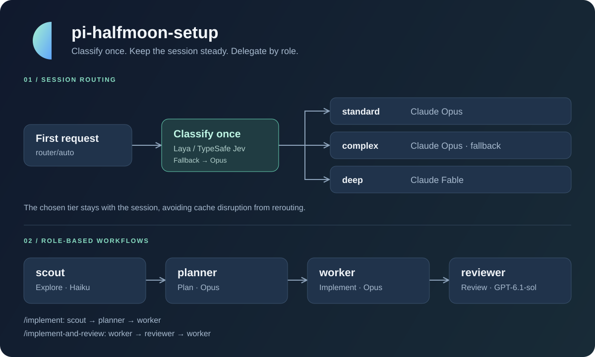

# pi-halfmoon-setup

[English](README.md) | **한국어**

[](https://github.com/halfmoon-mind/pi-halfmoon-setup/actions/workflows/test.yml)
[](LICENSE)

**첫 요청으로 모델을 고르고, 역할별 에이전트로 작업을 나누는 개인용 [pi](https://pi.dev) 설정 패키지.**

여러 머신에서 같은 모델 라우터, 서브에이전트, 워크플로 프롬프트를 사용할 수 있습니다. `router/auto`는 첫 사용자 메시지를 한 번 분류하고 세션 동안 선택한 티어를 유지해, 반복적인 모델 전환으로 프롬프트 캐시가 깨지는 일을 피합니다. 질문만 하는 `quick` 세션은 예외로, Sonnet보다 큰 모델이 필요한 메시지가 올 때까지 새 메시지마다 다시 분류합니다.



## 주요 기능

- **세션 단위 라우팅** — 메인 세션은 Opus로 두고, 논리 중심(`deep`)이거나 아주 어려운 작업은 Fable로 돌리며, thinking 레벨도 난이도에 맞춥니다.
- **역할별 서브에이전트** — 탐색·계획·구현·리뷰를 독립된 컨텍스트에서 수행합니다.
- **워크플로 명령어** — `/implement`, `/scout-and-plan`, `/implement-and-review`로 작업을 연결합니다.
- **계획 먼저, 깨끗한 컨텍스트에서 구현** — 간단한 수정보다 큰 코드 변경은 먼저 리뷰를 거친 계획 파일을 만들고, 세션이 얼마나 찼는지에 따라 새 세션이나 worker 서브에이전트에서 구현합니다.
- **종료 전 리뷰 게이트** — pi가 멈추기 전에 다른 모델 계열이 프롬프트의 변경을 리뷰하고, 막히는 문제는 다시 돌려보냅니다.
- **Claude CLI 연동** — 로그인된 `claude` CLI를 pi의 모델 프로바이더로 사용합니다.
- **PDF 읽기** — `read`가 PDF 각 페이지의 텍스트를 보내고, 그림이 있거나 텍스트가 없는 페이지만 이미지로 함께 보냅니다.
- **Office 파일 읽기** — `read`가 Word·Excel·PowerPoint 파일을 변경 추적, 댓글, 수식, 차트 숫자, 발표자 노트가 담긴 텍스트로 보내고, 이미지가 필요한 슬라이드만 이미지로 함께 보냅니다.
- **선택적인 로컬 분류기** — Laya를 자동 시작·종료하고, 분류할 수 없으면 Opus로 진행합니다.
- **샌드박스** — bash는 OS 샌드박스 안에서 실행되어 프로젝트와 임시 디렉터리에만 쓰고, 허용된 호스트에만 접속하며, 목록에 있는 자격 증명 경로는 읽지 못합니다. pi의 파일 도구도 같은 경로 규칙을 따르고, 위험한 몇 가지 동작은 먼저 확인을 받습니다.

## 빠른 시작

### 1. 준비 및 설치

`pi`와 Claude Code의 `claude` 명령어가 PATH에 있어야 하고, PDF를 읽으려면 poppler, Word 파일을 읽으려면 pandoc이 필요합니다(`brew install poppler pandoc`). PowerPoint 슬라이드 이미지에는 LibreOffice가 필요합니다(`brew install --cask libreoffice`). 없으면 해당 슬라이드에 들어 있는 그림 원본만 보냅니다. bash 샌드박스에는 ripgrep이 필요합니다(`brew install ripgrep`, Linux에서는 bubblewrap과 socat도: `apt-get install bubblewrap socat ripgrep`). 이 저장소는 독립 실행 앱이 아니라 pi에 로드하는 패키지입니다.

```bash
pi install git:github.com/halfmoon-mind/pi-halfmoon-setup
claude auth login
```

로컬 체크아웃을 사용하려면 의존성을 먼저 설치한 뒤 체크아웃을 설치합니다(pi는 로컬 소스의 의존성을 설치하지 않습니다). 수정 후 pi에서 `/reload`로 다시 로드할 수 있습니다.

```bash
cd ~/projects/pi-halfmoon-setup && npm ci
pi install ~/projects/pi-halfmoon-setup
```

`reviewer`·`plan-reviewer`·`deep-worker` 에이전트와 리뷰 게이트는 `openai` 프로바이더를 사용합니다. 해당 프로바이더의 인증도 준비해야 합니다. 환경변수로 설정하는 경우:

```bash
export OPENAI_API_KEY="<your-api-key>"
```

### 2. Laya 설치 (선택)

자동 분류를 사용하려면 Laya 서버를 설치합니다.

```bash
pip install "laya[serve]"
```

가상환경 등에 설치해 `laya-serve`가 PATH에 없다면 실행 파일 경로를 지정합니다. 아래 경로는 자신의 설치 위치로 바꾸세요.

```bash
export LAYA_SERVE_BIN="$HOME/projects/laya/.venv/bin/laya-serve"
```

Laya가 없어도 라우터는 `complex` 티어의 Opus를 사용합니다. 분류 없이 사용할 계획이라면 pi 안에서 `/laya off`를 실행하면 됩니다.

### 3. 실행

```bash
pi --model router/auto
```

실행 중에는 `/model`로 `router/auto`를 선택할 수도 있습니다. Laya를 사용하는 경우 `/laya`로 상태를 확인합니다.

시작할 때 이 패키지에 필요한데 이 머신에 없는 것(`claude` CLI나 그 로그인, `openai` 인증, poppler, pandoc, LibreOffice)을 경고하고, 첫 프롬프트 전까지 입력창 위에 워크플로 명령어를 한 줄로 보여 줍니다. pi가 로드한 스킬·확장 목록을 숨기려면 머신마다 `~/.pi/agent/settings.json`에 `"quietStartup": "header"`를 설정하세요. thinking 블록을 `Ctrl+T`를 누를 때만 펼치려면 같은 파일에 `"hideThinkingBlock": true`도 넣으세요. 작업 방향은 tool 호출만 봐도 알 수 있습니다. 이 키를 설정하기 전까지는 시작할 때 경고가 뜹니다. thinking을 계속 보면서 경고만 끄려면 `false`로 설정하세요.

## 사용 예시

pi 입력창에서 프롬프트 명령어 뒤에 작업을 적습니다.

```text
/scout-and-plan 로그인 흐름을 조사하고 세션 만료 처리 개선 계획을 세워줘
/implement 설정 파일에 테마 옵션을 추가해줘
/implement-and-review API 응답 파싱 오류를 수정하고 리뷰해줘
/deep 동시 요청에서도 토큰 버킷 rate limiter가 한도를 지키게 해줘
```

| 명령어 | 실행 순서 | 결과 |
|---|---|---|
| `/scout-and-plan` | scout → planner → plan-reviewer | 코드 탐색 및 리뷰를 거친 구현 계획. 구현은 하지 않음 |
| `/implement` | scout → planner → plan-reviewer → worker | 탐색, 계획, 계획 리뷰를 거쳐 구현 |
| `/implement-and-review` | worker → reviewer → worker | 구현, 리뷰, 리뷰의 Critical 항목 수정 |
| `/deep` | deep-worker (에스컬레이션 시 → worker) | 논리 중심 목표 하나를 GPT-6.1 Sol로 처리하고, 근거로 정할 수 없는 결정은 worker에게 넘김 |

프롬프트는 `subagent` 도구의 `chain` 모드를 사용하고 `{previous}`로 앞 단계의 출력을 전달합니다. 도구 자체는 단일 에이전트 실행(`agent` + `task`), 병렬 실행(`tasks`), 순차 실행(`chain`)을 지원합니다.

### 계획 먼저, 그리고 handoff

명령어 없이 동작합니다. 대화형 세션에서는 요청마다 계획이 필요한지 판단하라는 짧은 메모가 함께 전달됩니다. 간단한 수정(설계 선택 없이 한 문장으로 말할 수 있는 변경 하나)은 바로 구현합니다. 그 밖의 작업은 먼저 계획합니다. 모델이 코드를 읽고, 웹 검색이 있으면 외부 문서를 찾아보고, `planner`와 `plan-reviewer`를 거쳐 체크박스 단계와 성공 기준 명령이 담긴 계획을 `docs/plans/<이름>.md`에 씁니다. `handoff` 도구는 세션에서 `plan-reviewer`가 실행되기 전까지 계획을 거부합니다. 이 세션이 이미 받은 계획이나 `/handoff`로 연 계획은 예외입니다. 계획이 파일 3개 이상을 건드리거나 저장 데이터 형식·공개 인터페이스를 바꾸면, pi가 요약을 보여주고 승인을 기다립니다.

그다음 모델이 `handoff` 도구를 호출하고, 도구가 구현할 곳을 정합니다.

| 세션 상태 | 구현 위치 |
|---|---|
| 컨텍스트 50% 이상 사용, 또는 한 번 이상 압축됨 | 계획 파일로 시작하는 새 세션 (이전 세션이 부모로 연결됨) |
| 모델이 보기에 지저분함 (실패한 도구 호출과 리뷰 `BLOCK` 횟수를 보고 판단) | 모델이 요청하면 새 세션 |
| 그 외 | 현재 세션에서 `worker` 서브에이전트 |

구현 중에는 단계마다 계획 파일에 체크하고, 단계 사이에 `handoff`를 다시 호출해서 구현 도중 세션이 차면 남은 작업을 넘깁니다. 성공 기준 명령이 모두 통과할 때까지 끝내지 않습니다. worker의 pi에는 `handoff` 도구가 없으므로, 컨텍스트가 압축된 worker는 진행 중인 단계를 마치고 멈춥니다. 그러면 메인 세션이 `handoff`를 다시 호출한 뒤 남은 단계를 새 worker에게 넘깁니다. 계획은 서로 독립적이고 편집하는 파일이 겹치지 않는 큰 단계들을 하나의 병렬 그룹으로 묶을 수 있습니다. 구현하는 세션은 그 그룹을 단계마다 worker 하나씩 붙인 병렬 서브에이전트 호출 한 번으로 실행하고, worker들이 같은 작업 트리를 쓰므로 그 단계들의 확인과 체크는 직접 합니다. 리뷰 게이트는 체크된 단계를 코드와 대조하고, 계획 파일은 git에 올라가지 않으므로 체크만 바뀐 것도 리뷰할 변경으로 봅니다. 계획은 남은 단계가 있는 동안, 또는 그 요청에서 단계를 체크했을 때만 리뷰 기준이 됩니다. `/handoff <계획 파일>`로 직접 새 세션에서 계획을 시작할 수도 있습니다. 어느 경우든 새 세션의 첫 메시지에 계획 본문이 들어가므로, 라우터는 일반적인 시작 문구가 아니라 계획 내용으로 티어와 thinking 레벨을 정합니다.

계획 파일은 git에 올라가지 않습니다. `docs/plans/`를 무시하지 않는 저장소에서 pi가 시작되면 그 줄을 `.git/info/exclude`에 추가합니다. 이 파일은 로컬 전용이라 커밋되지 않습니다.

## 모델 선택

### 라우터 티어

| 티어 | 모델 설정 | 대상 작업 |
|---|---|---|
| `quick` | `pi-claude-cli/claude-sonnet-*` | 코드 변경 없는 질문, 설명, 인사 |
| `standard` | `pi-claude-cli/claude-opus-*` | 일반 기능 개발, 버그 수정, 리뷰, 문서 |
| `complex` | `pi-claude-cli/claude-opus-*` | 복잡한 설계, 여러 영역의 리팩터링, 어려운 디버깅. **기본 폴백** |
| `deep` | `pi-claude-cli/claude-fable-*` | 알고리즘, 백엔드 내부 구조, 수학 등 논리 중심 작업 |
| `complex-high` | `pi-claude-cli/claude-fable-*` | 난이도가 `xhigh`인 `complex` 작업 |

메인 세션은 GPT를 쓰지 않습니다. Opus가 기본이며, `quick` 질문은 Sonnet에서 `medium` thinking으로 돕니다. 이 세션은 새 사용자 메시지마다 다시 분류해, 실제 작업을 요청하는 메시지가 오면 Opus나 Fable로 옮겨 그대로 유지합니다. 이때 프롬프트 캐시가 한 번 깨집니다. 그 밖에 `deep` 작업은 Fable에서 돌고, 매우 어렵다(`xhigh`)고 판단한 `complex` 작업도 Fable로 올라갑니다. GPT는 다른 모델 계열로 리뷰하거나 논리 중심 하위 작업을 맡는 서브에이전트에만 씁니다. 티어는 푸터와 데이터셋 로그에서 작업 종류를 나타내는 데 계속 쓰입니다. 분류기가 `complex-high`를 직접 고르지는 않으며, 올라간 세션은 끝까지 그 모델을 유지합니다.

Claude의 `-*` 설정은 등록된 모델 카탈로그에서 해당 계열의 최신 숫자 버전을 선택합니다. 날짜가 붙은 스냅샷은 제외하므로, 실제 모델 버전은 pi의 카탈로그에 따라 달라집니다.

분류기는 첫 사용자 메시지의 최대 16,000자를 사용합니다. 선택된 답의 확률이 `0.5` 미만이거나 분류기에 접근할 수 없으면 `complex`를 사용합니다. `/laya off` 상태에서도 같은 티어를 사용합니다. 이는 **분류 실패에 대한 폴백**이며, 선택된 모델의 인증·호출 실패 시 다른 프로바이더로 전환하는 기능은 아닙니다.

같은 분류에서 요청의 난이도도 0~3점으로 함께 매겨, 세션의 thinking level을 `low`, `medium`, `high`, `xhigh` 중 하나로 정합니다. Laya가 2.5를 넘는 점수를 거의 주지 않아 `xhigh`는 2.15점부터입니다. Fable 세션(`deep`, `complex-high`)은 대신 `medium`으로 돌기 때문에, `xhigh`는 `standard` 세션에만 적용됩니다. pi의 레벨은 모든 Claude 모델에서 `claude` CLI의 같은 이름 `--effort` 레벨로 전달됩니다. pi에서 thinking level을 직접 바꾸면 그 세션의 나머지 동안은 사용자가 고른 값을 씁니다. 분류기가 답하지 못하거나 Laya가 꺼져 있으면 처음부터 사용자가 정한 값을 씁니다.

### 에이전트

| 에이전트 | 모델 설정 | 역할 |
|---|---|---|
| `scout` | `pi-claude-cli/claude-haiku:high` | 코드를 읽고 관련 파일과 핵심 맥락을 정리 |
| `planner` | `pi-claude-cli/claude-opus:high` | 탐색 결과와 요구사항으로 구현 계획 작성 |
| `plan-reviewer` | `openai/gpt-6.1-sol:xhigh` | worker가 실행하기 전에 다른 모델 계열로 계획의 막히는 문제를 고침 |
| `worker` | `pi-claude-cli/claude-opus:high` | 할당된 작업을 구현 |
| `deep-worker` | `openai/gpt-6.1-sol:medium` | 테스트로 확인할 수 있는 논리 중심 목표 하나를 구현하거나 `ESCALATE`로 답함 (oh-my-openagent의 deep-low 레인) |
| `reviewer` | `openai/gpt-6.1-sol:high` | 다른 모델 계열로 코드 품질과 보안 리뷰 |

에이전트의 Claude 모델명은 부분 이름이며 pi가 해석합니다. 역할과 모델은 [`agents/`](agents/)의 Markdown 파일에서 설정합니다. `subagent` 도구가 에이전트 목록과 `description`을 모델에 보여 주므로, 메인 모델이 논리 중심 하위 작업을 `deep-worker`에 맡기는 식으로 스스로 위임할 수 있습니다. 에이전트를 추가한 뒤에는 `/reload`를 실행하세요.

기본 `agentScope: "user"`는 패키지 에이전트와 `~/.pi/agent/agents/`를 로드하며, 같은 이름이면 사용자 설정이 우선합니다. 프로젝트의 `.pi/agents/`까지 사용하려면 도구 호출에 `agentScope: "both"`를 지정합니다. 이때 프로젝트 설정이 가장 우선합니다. `agentScope: "project"`는 프로젝트 에이전트만 로드합니다.

### 리뷰 게이트

Claude Code에서 Codex 플러그인이 하는 종료 전 리뷰와 같습니다. 프롬프트 실행 중에 저장소가 바뀌었으면, pi가 멈추기 전에 `reviewer` 에이전트가 그 변경을 리뷰합니다. 첫 줄은 `ALLOW` 또는 `BLOCK`이고, `BLOCK`이면 문제를 고치거나 문제가 아닌 이유를 설명하라는 메시지와 함께 모델로 돌아갑니다. 계획에서 나온 작업은 계획에 체크된 단계와도 대조합니다. 프롬프트당 리뷰는 최대 3번이고, 세 번째 이후의 변경은 리뷰되지 않았다는 경고를 띄웁니다. 실패하거나 시간 초과된 리뷰는 막지 않으며, 대화형 세션만 대상이라 서브에이전트가 자기 자신을 리뷰하지는 않습니다. 게이트가 꺼져 있으면 하단 표시줄에 `review off`가, 리뷰 중에는 `reviewing…`이 보이며, Esc로는 멈출 수 없지만 10분이 지나면 끝납니다.

| pi 명령어 | 동작 |
|---|---|
| `/review-gate` | 게이트가 켜져 있는지 표시 |
| `/review-gate on` | 게이트 켜기 (기본값) |
| `/review-gate off` | 같은 설정 디렉터리를 쓰는 모든 pi에서 게이트 끄기 |

### PDF 읽기

pi의 `read`는 PDF를 페이지별 텍스트 레이어(`pdftotext -layout`)로 보내고, 다음 페이지에만 긴 변 1,100px JPEG를 함께 보냅니다: 벡터 경로가 10개 이상인 페이지(차트, 다이어그램, 괘선 표), 그림이 들어 있는 페이지, 공백을 뺀 텍스트가 100자 미만인 페이지(스캔본). PDF에서 `offset`과 `limit`은 페이지 단위이며, 기본 10페이지, 한 번에 최대 20페이지입니다. 다른 파일은 pi의 기본 `read`가 처리합니다.

텍스트는 표의 숫자를 정확히 전달하고, 이미지는 텍스트에 없는 것을 전달하므로 이미지가 필요한 페이지에만 이미지를 붙입니다. 2단 논문, FOMC 경제전망 보고서, 스캔한 논문에서 각각 6페이지를 골라 문서마다 본문·표·차트에 관한 12문제를 `claude -p`(Opus 5.5, medium effort)로 2~3번씩 물어 측정했습니다:

| PDF를 보내는 방식 | 토큰 (논문 / 보고서 / 스캔본) | 정답 |
|---|---|---|
| 텍스트 레이어만 | 15.0K / 4.6K / 0.1K | 34/72: 차트와 스캔본은 답하지 못함 |
| 모든 페이지를 100dpi 이미지로 (Claude Code `Read`의 `pages` 사용 시) | 7.5K / 7.5K / 7.8K | 69/72: 빽빽한 표에서 잘못 읽음 |
| PDF 전체를 document 블록으로 (Claude Code `Read`의 `pages` 미사용 시) | 24.2K / 13.9K / 9.5K | 72/72 |
| 이 확장 | 19.4K / 11.8K / 7.9K | 108/108 |

### Office 파일 읽기

`read`는 `.docx`, `.xlsx`, `.pptx`(매크로가 든 `m` 버전 포함)도 엽니다. 파일의 XML에 정확히 들어 있는 것은 텍스트로 보내고, 텍스트로 전달되지 않는 것만 이미지로 보냅니다.

- **Word**: pandoc의 Markdown(`pandoc -s -t gfm --track-changes=all`)으로 보내므로 변경 추적의 삽입·삭제와 댓글이 `<span>` 태그로 남습니다. 내장 그림은 원래 위치에 이미지로 넣고, pandoc이 빠뜨리는 머리글·바닥글 텍스트를 앞에 붙입니다. `offset`과 `limit`은 줄 단위입니다.
- **Excel**: 시트마다 열 문자와 행 번호가 붙은 그리드로 보냅니다. 값은 숫자 서식대로 보이는 모습으로 쓰고, 수식은 값 뒤에, 병합 범위는 시트 머리에 적습니다. 시트를 렌더링하면 좁은 열이 잘리고(`###`) 수식과 셀 주소를 잃어서 이미지는 보내지 않습니다. `offset`과 `limit`은 줄 단위입니다.
- **PowerPoint**: 슬라이드마다 제목, 본문, 표, 차트 숫자(차트 XML에서 꺼내므로 데이터 레이블이 없어도 정확), 발표자 노트를 보냅니다. 그림, 연결선, 다이어그램, 텍스트 상자가 아닌 도형이 있는 슬라이드만 LibreOffice로 렌더링한 긴 변 1,100px JPEG를 함께 보냅니다. LibreOffice가 없으면 그 슬라이드에 들어 있는 그림 원본만 붙입니다. `offset`과 `limit`은 슬라이드 단위이며, 기본 10장, 한 번에 최대 20장입니다.

형식마다 보내는 방식별로 잃을 수 있는 것을 담은 테스트 문서를 하나씩 만들어 측정했습니다. 변경 추적, 댓글, 병합 셀 표, 차트 그림, 머리글이 든 계약서; 수식, 병합 헤더, 시트 간 참조, 거래 150행이 든 예산 통합문서; 데이터 레이블 없는 차트, 발표자 노트, 스크린샷, 화살표 순서도, 색으로만 표시한 상태가 든 발표 자료입니다. 문서마다 12문제를 `claude -p`(Opus 5.5, medium effort)로 3번씩 묻고, 정답 키를 준 Sonnet이 채점했습니다. 형식마다 문서가 하나이고 질문은 방식별로 빠지는 정보를 노렸으므로, 이 표는 얼마나 자주 틀리는지보다 무엇을 놓치는지를 보여 줍니다.

| 파일을 보내는 방식 | 토큰 | 정답 | 놓친 것 |
|---|---|---|---|
| Word 텍스트만 (textutil, markitdown, pandoc 기본값) | 0.3–0.6K | 21/36 | 수정 전 문구, 삭제된 문장, 댓글, 차트 그림, 머리글 |
| Word 페이지 이미지, 또는 렌더링한 PDF를 PDF 읽기로 | 2.5K / 3.0K | 33/36 | 댓글 |
| **Word, 이 확장** | **1.1K** | **36/36** | |
| Excel CSV 또는 markitdown | 4.3K / 5.7K | 33/36 | 수식 |
| Excel을 Numbers 또는 LibreOffice로 렌더링한 페이지 이미지 | 5.7K / 8.8K | 32/36, 30/36 | 수식, 잘린 셀 |
| Excel을 Numbers 또는 LibreOffice로 렌더링해 PDF 읽기로 | 7.7K / 7.2K | 30/36, 24/36 | 수식, 셀 주소, 잘린 셀 |
| **Excel, 이 확장** | **6.7K** | **36/36** | |
| PowerPoint markitdown 텍스트 | 0.7K | 27/36 | 스크린샷, 화살표, 색 |
| PowerPoint 슬라이드 이미지, 또는 렌더링한 PDF를 PDF 읽기로 | 10.4K / 7.9K | 33/36 | 발표자 노트 |
| PowerPoint, 이 확장 (LibreOffice 없음) | 1.1K | 30/36 | 화살표, 색 |
| **PowerPoint, 이 확장** | **3.5K** | **36/36** | |

### 샌드박스

bash는 [`@anthropic-ai/sandbox-runtime`](https://github.com/anthropics/sandbox-runtime) 안에서 실행됩니다(macOS는 sandbox-exec, Linux는 bubblewrap). pi 프로세스 안에서 도는 파일 도구(`read`, `grep`, `find`, `ls`, `write`, `edit`, `handoff`의 계획 파일 읽기)는 실행 전에 같은 경로 규칙으로 검사합니다.

- **쓰기**는 프로젝트, 임시 디렉터리, `/tmp`에만 됩니다. 프로젝트는 pi가 실행되는 디렉터리입니다. 런타임이 항상 보호하는 이름(`.bashrc`, `.zshrc`, `.gitconfig`, `.git/hooks`, `.git/config`, `.vscode`, `.claude/commands` 등)을 그 디렉터리와 그 아래에서만 보호하기 때문입니다. 이 패키지는 git이 다른 곳의 설정을 읽게 만들 수 있는 프로젝트의 `.git/commondir`, `.git/config.worktree`, `.git/modules/`, `.git/worktrees/`도 막습니다. 그래서 bash에서 서브모듈이나 worktree를 추가하려면 위험도 판정을 거쳐야 합니다. Linux에서는 런타임이 없는 경로 자리에 빈 파일을 끼워 git이 깨지므로, pi가 먼저 `.`(저장소 자신의 디렉터리)을 담은 `commondir`을 만들고 그 파일을 읽기 전용으로 막습니다. `.git`, `.claude`, `.vscode`, `.idea` 안에서 시작한 pi에는 프로젝트가 없습니다. 서브에이전트처럼 UI가 없는 pi는 자신의 `cwd`가 자신을 띄운 pi의 프로젝트 안에 있을 때만 그 `cwd`를 프로젝트로 받으므로, `cwd` 인자로 쓰기 범위를 좁힐 수는 있어도 넓힐 수는 없습니다. pi의 에이전트 디렉터리(`~/.pi/agent`)는 언제나 쓸 수 없습니다. 임시 디렉터리에서는 bash에 이 보호가 걸리지 않아, `/tmp` 아래 저장소의 hooks는 bash가 바꿀 수 있습니다. pi의 파일 도구는 보호되는 이름을 어디서든 거부합니다.
- **읽기**는 `~/.ssh`(그 안의 `config`와 `known_hosts`는 읽을 수 있음), `~/.aws`, `~/.gnupg`, `~/.netrc`, `~/.config/gh`, `~/.pi/agent/auth.json`을 빼고 열려 있습니다. 이 중 하나를 품은 디렉터리를 `grep`하는 것도 막습니다. 다른 곳에 있거나 환경 변수에 든 자격 증명은 보호하지 않습니다.
- **네트워크**는 `github.com`, `*.github.com`, `*.githubusercontent.com`, `registry.npmjs.org`, `pypi.org`, `files.pythonhosted.org`에 접속합니다. 다른 호스트는 `openai/gpt-6.1-terra`가 세션마다 한 번 평가합니다. low(패키지 레지스트리, 툴체인 다운로드, 작업에 필요한 문서)면 경고와 함께 세션 동안 허용하고, high이거나 분류기가 실패하면 사용자에게 묻고, UI가 없는 pi(서브에이전트, 리뷰 게이트, `pi -p`)는 세션 동안 거부합니다. 허용된 호스트는 이후 명령이 읽을 수 있는 모든 것을, 프로젝트 파일까지 받을 수 있습니다. `PI_SANDBOX_ESCALATE=off`면 다른 호스트는 모두 사용자에게 묻고, UI가 없으면 거부합니다. macOS에서는 `SSH_AUTH_SOCK`에 접근할 수 있지만, 그것만으로 ssh를 통한 git이 동작하지는 않습니다.
- **확인**: `sudo`, `git … push`, 재귀 `rm`이 든 bash와, 이름이 `.env`로 시작하는 파일의 `write`/`edit`는 먼저 묻고, UI가 없으면 막습니다. 명령 텍스트로 판단하므로 경계가 아니라 과속 방지턱입니다.
- **에스컬레이션**: 샌드박스 안의 bash 명령이 실패하고 샌드박스 차단 흔적(`Operation not permitted`, `EPERM`, 읽기 전용 파일 시스템, 막힌 호스트)이 보이면, `openai/gpt-6.1-terra`가 그 명령을 샌드박스 없이 실행할 때의 위험을 평가합니다. low면 같은 명령을 샌드박스 밖에서 다시 실행하고, 출력에 표시 줄을 남기고 경고를 띄웁니다. high면 사용자에게 묻고, UI가 없으면(서브에이전트, 리뷰 게이트, `pi -p`) 거부하며 모델에게 사용자에게 물어보라고 알립니다. `sudo`, `git push`, `rm -r`은 항상 사용자에게 가고, 실행 중에 호스트가 거부된(사용자가 거절했거나, UI 없이 high로 평가된) 명령(다시 실행하기 직전에 한 번 더 확인)은 다시 실행하지 않습니다. 명령, 차단 줄, 사용자의 마지막 메시지가 OpenAI로 전송됩니다. 알 수 없는 호스트는 호스트, 포트, 실행 중인 명령 최대 5개(각 2000자, 런타임이 어느 명령의 요청인지 알려주지 않음), 사용자의 마지막 메시지가 전송됩니다. OpenAI 인증이 없거나, 분류기 오류나 불완전한 응답은 모두 high로 칩니다. 다시 실행할 때는 샌드박스가 전혀 없고(쓰기 제한, 호스트 허용 목록, 자격 증명 읽기 차단 모두 없음), 분류기는 경계가 아니라 과속 방지턱입니다. 명령이나 출력 속 프롬프트 인젝션, 또는 가짜 차단 문구를 출력하는 명령으로 샌드박스 없이 실행될 수 있습니다. 차단되기 전에 일부 실행된 명령은 한 번 더 실행됩니다. 감지는 최선 노력일 뿐이라, OS 메시지를 감추는 Java나 Gradle 오류는 감지하지 못하고 그냥 실패로 남습니다. `PI_SANDBOX_ESCALATE=off`로 에스컬레이션과 호스트 평가를 끕니다.
- **powershell**: pi의 `powershell` 도구는 OS 샌드박스 밖에서 실행되므로, 샌드박스가 켜져 있으면 막습니다. bash를 쓰세요.

기본값은 `~/.pi/agent/sandbox.json`으로 넓힙니다. 목록은 기본값 뒤에 덧붙고, 단일 값은 기본값을 바꿉니다. 파일 시스템 항목은 경로입니다(`~`와 프로젝트 기준 상대 경로는 되고, glob은 거부). 형식이 잘못된 파일이면 샌드박스가 시작하지 않습니다.

```json
{"filesystem": {"allowWrite": ["~/.npm"]}, "network": {"allowedDomains": ["example.com"]}}
```

쓰기 가능한 디렉터리를 하나 더할 때마다 bash가 거기에 코드를 심어 나중에 샌드박스 밖에서 실행되게 할 수 있습니다(`~/.npm`, `~/.cache` 같은 도구 캐시에는 코드가 들어 있습니다). 그래서 기본값에는 하나도 없습니다.

실패하면 닫힙니다. 샌드박스가 뜨기 전이나 뜨지 못할 때(로컬 체크아웃에서 `npm ci`를 하지 않아 sandbox-runtime이 없거나, ripgrep이 없거나, Linux에 bubblewrap이나 socat이 없을 때) bash와 검사 대상 도구는 이유와 해결 방법을 담아 막히고, bash가 샌드박스 없이 실행되는 일은 없습니다. `PI_SANDBOX=off pi`는 두 층을 모두 끄고, 시작할 때 경고를 띄웁니다.

프로젝트가 이 패키지의 체크아웃 자체라면 `node_modules/`, `package.json`, `package-lock.json`, `.npmrc`만 보호합니다. 의존성은 직접 연 터미널에서 바꾸세요. 소스는 계속 수정할 수 있고, 그 수정은 `/reload`, 재시작, 또는 다음 서브에이전트 시작 때 샌드박스 밖에서 실행됩니다. 프로젝트가 로드된 패키지를 품고 있으면 pi가 시작할 때 경고합니다. bash가 패키지 코드를 바꿀 수 없게 하려면 git으로 설치하고 별도 체크아웃에서 작업하거나, 체크아웃을 `filesystem.denyWrite`에 추가하세요.

다루지 않는 것: `!`나 `!!`로 직접 입력한 명령, Claude CLI 자체의 WebSearch와 WebFetch, pi 프로세스 자체와 pi가 신뢰하는 확장(신뢰한 프로젝트의 `.pi` 확장 포함), `read`가 실행하는 poppler·pandoc·LibreOffice 변환기, 도구의 검사와 실제 사용 사이에 파일이 바뀌는 경우. `sandbox.ts` 자체가 로드되지 않으면 pi는 그것을 건너뛰고, 아무것도 샌드박스되지 않습니다. 샌드박스 테스트(`extensions/sandbox.test.ts`)는 신뢰할 수 있는 터미널이나 CI에서 실행하세요. 실제 샌드박스는 다른 샌드박스 안에서 시작하지 못합니다.

## 분류기 설정

기본값은 로컬 Laya입니다. pi의 TypeSafe Jev 클라이언트를 로컬 서버에 연결하므로 두 모드 모두 분류기 식별자가 `typesafe/jev-latest`로 표시될 수 있습니다.

| 환경변수 | 기본값 | 설명 |
|---|---|---|
| `PI_ROUTER_CLASSIFIER` | `laya` | 로컬 `laya` 또는 TypeSafe `jev` |
| `LAYA_URL` | `http://127.0.0.1:8000/v1` | Laya 서버 주소. 호스트가 `127.0.0.1` 또는 `localhost`일 때만 프로세스를 자동 관리 |
| `LAYA_SERVE_BIN` | `laya-serve` | 자동 실행할 서버의 실행 파일 경로 |
| `LAYA_MODELS` | `english` | 자동 시작하는 Laya 서버에 전달할 모델 설정 |
| `TYPESAFE_API_KEY` | 없음 | `jev` 모드에서 사용할 API 키 |

TypeSafe Jev를 사용하려면 pi를 시작하기 전에 설정합니다.

```bash
export PI_ROUTER_CLASSIFIER=jev
export TYPESAFE_API_KEY="<your-api-key>"
pi --model router/auto
```

### Laya 수명과 상태

- `router/auto` 세션 시작 또는 모델 선택 시 로컬 서버를 미리 시작합니다.
- 분류 이후 5분 동안 사용하지 않으면 자신이 시작한 서버를 종료하고, 필요할 때 다시 시작합니다.
- pi 종료·리로드 시 서버를 정리하며, 별도 lifeline 프로세스가 비정상 종료 시에도 서버를 종료하도록 구성되어 있습니다.
- 시작 대기 제한은 30초입니다. 코드에 기록된 측정치는 콜드 스타트 약 10초, 메모리 약 2.5GB이며 환경에 따라 달라집니다.

| pi 명령어 | 동작 |
|---|---|
| `/laya` | 현재 상태 표시 |
| `/laya on` | 분류 활성화 및 서버 시작 재시도 |
| `/laya off` | 분류 비활성화 및 로컬 Laya 종료 |

스위치는 기본적으로 `~/.pi/agent/laya.json`에 저장되어 같은 설정 디렉터리를 사용하는 pi 인스턴스에 적용됩니다. `PI_CODING_AGENT_DIR`을 설정하면 저장 위치도 달라집니다. 이미 라우팅된 세션은 선택한 티어를 유지하므로 변경된 분류 동작은 새 세션에서 확인하세요.

푸터에는 `laya starting`, `laya on`, `laya idle`, `laya unavailable`, `laya off` 상태가 표시됩니다. `/laya off`는 해당 로컬 포트에서 실행 중인 다른 pi 또는 수동 실행의 `laya-serve`도 종료할 수 있습니다.

### 데이터셋 로그

새로 라우팅된 세션마다 `~/.pi/agent/laya-dataset.jsonl`에 JSON 한 줄이 추가됩니다(`PI_CODING_AGENT_DIR`을 따름). Laya가 본 프롬프트(최대 16,000자), 티어별 확률, 난이도 원점수, 실제 사용한 티어·모델·thinking 레벨이 기록됩니다. Laya가 꺼진 상태로 라우팅된 세션은 답 없이 기록됩니다. `session`은 pi 세션 파일과 같은 값이며, 그 파일의 `thinking_level_change`, `model_change` 항목으로 사용자가 라우팅을 바꾼 지점을 알 수 있습니다. 프롬프트 원문이 담기므로 세션 파일처럼 다루세요.

## 문제 해결

| 증상 | 확인할 사항 |
|---|---|
| `laya unavailable` 또는 서버 시작 경고 | `laya[serve]` 설치와 `LAYA_SERVE_BIN` 경로를 확인한 뒤 `/laya on` 실행 |
| Laya 없이 계속 사용하고 싶음 | `/laya off` 실행. 새 세션은 Opus로 라우팅 |
| `pi-claude-cli` 프로바이더 로드 실패 | `claude`가 PATH에 있는지, `claude auth login`이 완료됐는지 확인 |
| `is not in the model catalog` | 선택된 프로바이더의 로드 여부와 pi 모델 카탈로그 확인 |
| `deep-worker`, 리뷰 단계, 리뷰 게이트의 인증 오류 | `openai` 프로바이더 인증 및 해당 모델 접근 권한 확인 |
| 프로젝트 에이전트가 선택되지 않음 | `agentScope: "both"` 또는 `"project"` 사용 여부 확인 |
| PDF를 읽을 때 `pdfinfo not found` | poppler 설치: `brew install poppler` 또는 `apt-get install poppler-utils` |
| .docx를 읽을 때 `pandoc not found` | pandoc 설치: `brew install pandoc` 또는 `apt-get install pandoc` |
| .pptx를 읽을 때 LibreOffice가 슬라이드를 렌더링하지 못했다고 나옴 | LibreOffice 설치: `brew install --cask libreoffice`. 설치 전까지 해당 슬라이드에는 그림 원본만 붙음 |

Claude 요청은 `claude -p`를 통해 실행됩니다. 따라서 Claude Code의 사용자 설정, 훅, 플러그인이 요청에 영향을 줄 수 있습니다. Claude Code의 MCP 서버와 내장 도구는 웹 검색·가져오기 외에는 쓰지 않습니다. pi의 도구는 MCP 서버를 거쳐 Claude에 전달되고, `claude` 프로세스 하나가 턴 사이에도 대화를 유지합니다. 인증 정보와 머신별 UI 설정은 저장소가 아닌 각 머신의 pi·Claude 설정에서 관리하세요.

## 저장소 구조

```text
agents/                     역할별 프롬프트와 모델 설정
prompts/                    슬래시 명령어용 워크플로 템플릿
extensions/
  router.ts                 router/auto 및 Laya 프로세스 관리
  router.test.ts            라우터 테스트
  sandbox.ts                bash용 OS 샌드박스와 pi 파일 도구에 쓰는 같은 경로 검사
  footer.ts                 라우팅된 tier와 모델을 보여 주는 2줄 하단 표시줄
  review-gate.ts            프롬프트마다 변경을 리뷰하는 종료 전 게이트
  handoff.ts                계획 먼저 메모, handoff 도구, /handoff
  pdf-read.ts               PDF용 read: 페이지 텍스트와 필요한 페이지의 이미지
  office-read.ts            .docx·.xlsx·.pptx용 read: 텍스트와 필요한 곳의 이미지
  tab-follow-up.ts          에이전트 실행 중 Tab으로 후속 질문 대기열에 추가
  test-hooks.ts             테스트에서 pi 패키지를 pi와 같은 방식으로 불러오는 설정
  subagent/                 서브에이전트 실행 및 에이전트 탐색
  pi-claude-cli/            Claude CLI 프로바이더
docs/images/                README 구성도와 GitHub 소셜 미리보기 이미지
```

## 테스트

Node.js 22.18 이상과 pi가 설치된 환경에서 저장소 루트를 기준으로 실행합니다.

```bash
npm test
```

라우터의 분류·폴백·모델 선택·프로세스 수명, 서브에이전트의 에이전트 로드와 chain 실행, 리뷰 게이트의 변경 감지·판정·계획 대조, handoff의 세션 신호·유지/이동 판단·새 세션 생성·계획 파일 git 제외, `read`가 이미지를 붙이는 PDF 페이지와 페이지 범위, Word 변경 추적·Excel 셀과 수식·PowerPoint 차트 숫자와 노트와 그림을 보내는 방식, Claude CLI 프로바이더의 시스템 프롬프트 전달·도구 호출·CLI 오류 처리를 검증합니다. pi 패키지는 설치된 pi(`~/.pi/agent/install`)에서 불러오고, `pi`와 `claude` 실행은 가짜 프로세스로 대체합니다. 실제 모델 프로바이더 인증과 전체 워크플로 실행은 별도로 확인해야 합니다.

GitHub Actions는 push·PR마다, 그리고 매주 npm의 최신 pi를 설치해 같은 테스트를 실행합니다. 그래서 pi 업데이트로 이 패키지가 깨지면 바로 드러납니다.

## 라이선스 및 출처

[MIT](LICENSE). `subagent` 확장은 pi의 예제에서 가져왔으며 패키지 내 에이전트를 로드하도록 수정했습니다. Claude CLI 프로바이더는 `pi-claude-cli` 0.3.1을 가져와 pi 0.99에 맞게 수정한 코드이며, 해당 [MIT 라이선스](extensions/pi-claude-cli/LICENSE)를 포함합니다.
