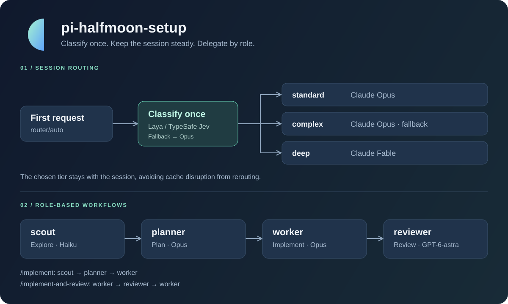

# pi-halfmoon-setup

**English** | [한국어](README.ko.md)

[](https://github.com/halfmoon-mind/pi-halfmoon-setup/actions/workflows/test.yml)
[](LICENSE)

**A personal [pi](https://pi.dev) package that picks a model from the first request and splits work across role-based agents.**

Use the same model router, subagents, and workflow prompts on every machine. `router/auto` classifies the first user message once and keeps the chosen tier for the whole session, so repeated model switches never break the prompt cache. The exception is a question-only `quick` session, which classifies each new message until one needs more than Sonnet.



## Features

- **Per-session routing** — keeps the main session on Opus, runs logic-heavy (`deep`) and very hard work on Fable, and sets thinking to match.
- **Role-based subagents** — explore, plan, implement, and review in isolated contexts.
- **Workflow commands** — chain work with `/implement`, `/scout-and-plan`, and `/implement-and-review`.
- **Stop-time review gate** — another model family reviews each prompt's changes before pi stops, and sends blocking issues back.
- **Claude CLI provider** — uses your logged-in `claude` CLI as a pi model provider.
- **PDF reading** — `read` sends each PDF page's text, plus an image of only the pages with figures or no text.
- **Office file reading** — `read` sends Word, Excel and PowerPoint files as text with tracked changes, comments, formulas, chart data and speaker notes, plus an image of only the slides that need one.
- **Optional local classifier** — starts and stops Laya automatically, and falls back to Opus when it cannot classify.

## Quick start

### 1. Prerequisites and install

`pi` and Claude Code's `claude` command must be on your PATH, poppler for reading PDFs and pandoc for Word files (`brew install poppler pandoc`), and LibreOffice for PowerPoint slide images (`brew install --cask libreoffice`; without it, those slides come with their embedded pictures only). This repository is not a standalone app; it is a package that pi loads.

```bash
pi install git:github.com/halfmoon-mind/pi-halfmoon-setup
claude auth login
```

To use a local checkout instead, install it like this. After editing, run `/reload` in pi to load the changes.

```bash
pi install ~/projects/pi-halfmoon-setup
```

The `reviewer`, `plan-reviewer`, and `deep-worker` agents and the review gate use the `openai` provider, so set up its authentication too. With an environment variable:

```bash
export OPENAI_API_KEY="<your-api-key>"
```

### 2. Install Laya (optional)

For automatic classification, install the Laya server.

```bash
pip install "laya[serve]"
```

If `laya-serve` is not on your PATH, for example because it lives in a virtualenv, point to the executable. Replace the path below with your install location.

```bash
export LAYA_SERVE_BIN="$HOME/projects/laya/.venv/bin/laya-serve"
```

Without Laya, the router uses Opus from the `complex` tier. If you plan to run without classification, run `/laya off` in pi.

### 3. Run

```bash
pi --model router/auto
```

You can also pick `router/auto` with `/model` while pi is running. If you use Laya, check its state with `/laya`.

At startup, pi warns about anything this package needs that the machine lacks (the `claude` CLI or its login, `openai` credentials, poppler, pandoc, LibreOffice), and a line above the editor lists the workflow commands until the first prompt. To hide pi's list of loaded skills and extensions, set `"quietStartup": "header"` in `~/.pi/agent/settings.json` on each machine.

## Usage

In pi's input box, type a prompt command followed by the task.

```text
/scout-and-plan Investigate the login flow and plan better session-expiry handling
/implement Add a theme option to the config file
/implement-and-review Fix the API response parsing error and review the fix
/deep Make the token bucket rate limiter hold its limit under concurrent requests
```

| Command | Steps | Result |
|---|---|---|
| `/scout-and-plan` | scout → planner → plan-reviewer | Code exploration and a reviewed implementation plan, with no implementation |
| `/implement` | scout → planner → plan-reviewer → worker | Implementation after exploration, planning, and plan review |
| `/implement-and-review` | worker → reviewer → worker | Implementation, review, and fixes for the review's Critical issues |
| `/deep` | deep-worker (→ worker if it escalates) | One logic-heavy goal on GPT-6.1 Sol, handed to the worker when evidence cannot settle a decision |

The prompts use the `subagent` tool's `chain` mode and pass each step's output to the next with `{previous}`. The tool itself supports a single agent (`agent` + `task`), parallel runs (`tasks`), and sequential runs (`chain`).

## Model selection

### Router tiers

| Tier | Model setting | Used for |
|---|---|---|
| `quick` | `pi-claude-cli/claude-sonnet-*` | Questions, explanations, and greetings that ask for no code change |
| `standard` | `pi-claude-cli/claude-opus-*` | Everyday features, bug fixes, reviews, docs |
| `complex` | `pi-claude-cli/claude-opus-*` | Complex design, cross-cutting refactors, hard debugging. **Default fallback** |
| `deep` | `pi-claude-cli/claude-fable-*` | Logic-heavy work such as algorithms, backend internals, and math |
| `complex-high` | `pi-claude-cli/claude-fable-*` | `complex` work rated `xhigh` |

The main session never runs on GPT. Opus is the default; a `quick` question runs on Sonnet at `medium` thinking, and each new user message in that session is classified again, so the session moves to Opus or Fable (and stays there) once a message asks for real work. That move costs one prompt-cache miss. `deep` work runs on Fable, and `complex` work rated very hard (`xhigh`) moves up to Fable. GPT stays in subagents, where a different model family reviews or takes logic-heavy subtasks. The tier still labels the work in the footer and the dataset log. The classifier never picks `complex-high` directly, and an escalated session stays on that model.

A Claude `-*` setting picks the newest numbered version of that family in the registered model catalog. Dated snapshots are excluded, so the actual model version depends on pi's catalog.

The classifier reads up to 16,000 characters of the first user message. When the chosen answer's probability is below `0.5` or the classifier is unreachable, the router uses `complex`. It also uses that tier while Laya is switched off with `/laya off`. This is a **fallback for failed classification**; it does not switch to another provider when the chosen model fails to authenticate or respond.

The same classification also scores how hard the request is from 0 to 3, and the session runs at `low`, `medium`, `high`, or `xhigh` thinking to match; `xhigh` starts at 2.15, since Laya rarely scores above 2.5. A Fable session (`deep` or `complex-high`) runs at `medium` instead, so `xhigh` only reaches a `standard` session. pi's level goes to the `claude` CLI's `--effort` level of the same name for every Claude model. If you pick a thinking level yourself in pi, yours is used for the rest of the session. When the classifier cannot answer, or Laya is off, your level is used from the start.

### Agents

| Agent | Model setting | Role |
|---|---|---|
| `scout` | `pi-claude-cli/claude-haiku:high` | Reads the code and summarizes the relevant files and key context |
| `planner` | `pi-claude-cli/claude-opus:high` | Writes an implementation plan from the exploration and the requirements |
| `plan-reviewer` | `openai/gpt-6-astra:xhigh` | Fixes blockers in the plan with a different model family before the worker runs it |
| `worker` | `pi-claude-cli/claude-opus:high` | Implements the assigned task |
| `deep-worker` | `openai/gpt-6.1-sol:medium` | Delivers one logic-heavy goal that tests can settle, or replies `ESCALATE` (oh-my-openagent's deep-low lane) |
| `reviewer` | `openai/gpt-6.1-sol:high` | Reviews code quality and security with a different model family |

The agents' Claude model names are partial names that pi resolves. Set roles and models in the Markdown files in [`agents/`](agents/). The `subagent` tool lists the agents with their `description`, so the main model can delegate on its own, for example a logic-heavy subtask to `deep-worker`; run `/reload` after adding an agent.

The default `agentScope: "user"` loads the package's agents and `~/.pi/agent/agents/`; when names collide, your user agents win. To also use the project's `.pi/agents/`, pass `agentScope: "both"` in the tool call, and project agents take the highest priority. `agentScope: "project"` loads only project agents.

### Review gate

Like the Codex plugin's stop-time review in Claude Code: when a prompt's run changed the repository, the `reviewer` agent reviews those changes before pi stops. Its first line is `ALLOW` or `BLOCK`, and a `BLOCK` goes back to the model as a message to fix the issue or explain why it is not one. Each prompt gets at most three reviews, a failed or timed-out review never blocks, and only interactive sessions are gated, so subagents never review themselves. While the gate is off, the footer shows `review off`. While a review runs, it shows `reviewing…`; Esc cannot stop it, but it times out after 10 minutes.

| pi command | Action |
|---|---|
| `/review-gate` | Show whether the gate is on |
| `/review-gate on` | Turn the gate on (the default) |
| `/review-gate off` | Turn the gate off for every pi that shares this config directory |

### PDF reading

pi's `read` sends a PDF as each page's text layer (`pdftotext -layout`), plus a JPEG, 1,100 px on its long side, of the pages that draw (10 or more vector paths: charts, diagrams, ruled tables), embed a picture, or have under 100 characters of text (scans). For a PDF, `offset` and `limit` count pages: 10 by default, at most 20 per call. Other files go to pi's own `read`.

Text keeps table numbers exact, and an image carries what text cannot, so a page gets an image only when it needs one. Measured on six pages each of a two-column paper, an FOMC projections report, and a scanned paper, with 12 questions per document on prose, tables, and charts, asked through `claude -p` on Opus 5.5 at medium effort, twice or three times each:

| How the PDF is sent | Tokens (paper / report / scan) | Correct |
|---|---|---|
| Text layer only | 15.0K / 4.6K / 0.1K | 34/72: no charts, nothing from the scan |
| Every page as a 100 dpi image (Claude Code's `Read` with `pages`) | 7.5K / 7.5K / 7.8K | 69/72: misreads in dense tables |
| The whole PDF as a document block (Claude Code's `Read` without `pages`) | 24.2K / 13.9K / 9.5K | 72/72 |
| This extension | 19.4K / 11.8K / 7.9K | 108/108 |

### Office file reading

`read` also opens `.docx`, `.xlsx` and `.pptx` (and their macro-enabled `m` versions). Each goes as text where the file's XML holds the answer exactly, and as an image only where text misses it:

- **Word**: pandoc's Markdown (`pandoc -s -t gfm --track-changes=all`), so tracked insertions, deletions and comments show as `<span>` tags, with each embedded picture where it sits and the page header and footer text, which pandoc drops. `offset` and `limit` count lines.
- **Excel**: each sheet as a grid with column letters and row numbers, values as their number format shows them, each formula after its value, and merged ranges. No images: a rendered sheet cuts off narrow columns (`###`) and loses formulas and cell addresses. `offset` and `limit` count lines.
- **PowerPoint**: each slide's titles, text, tables, chart data (from the chart's own XML, so exact even without data labels) and speaker notes, plus a 1,100 px JPEG, rendered through LibreOffice, of each slide with a picture, a connector, a diagram, or a drawn shape that is not a text box. Without LibreOffice those slides come with their embedded pictures only. `offset` and `limit` count slides: 10 by default, at most 20 per call.

Measured on one test document per format, built to hold what each way of sending can lose: a contract with tracked changes, a comment, a merged-cell table, a chart picture and a page header; a budget workbook with formulas, merged headers, a cross-sheet reference and 150 transaction rows; a review deck with charts without data labels, speaker notes, a screenshot, an arrow flowchart, and status shown only by color. Each had 12 questions, asked three times through `claude -p` on Opus 5.5 at medium effort, and graded by Sonnet against an answer key. With one document per format and questions aimed at what each way drops, the table shows what each way misses more than how often.

| How the file is sent | Tokens | Correct | Misses |
|---|---|---|---|
| Word as text only (textutil, markitdown, pandoc's defaults) | 0.3–0.6K | 21/36 | The text before revision, the deleted sentence, the comment, the chart picture, the header |
| Word as page images, or as a rendered PDF through PDF reading | 2.5K / 3.0K | 33/36 | The comment |
| **Word through this extension** | **1.1K** | **36/36** | |
| Excel as CSV or markitdown | 4.3K / 5.7K | 33/36 | Formulas |
| Excel rendered by Numbers or LibreOffice, as page images | 5.7K / 8.8K | 32/36, 30/36 | Formulas, cut-off cells |
| Excel rendered by Numbers or LibreOffice, through PDF reading | 7.7K / 7.2K | 30/36, 24/36 | Formulas, cell addresses, cut-off cells |
| **Excel through this extension** | **6.7K** | **36/36** | |
| PowerPoint as markitdown text | 0.7K | 27/36 | The screenshot, the arrows, the colors |
| PowerPoint as slide images, or as a rendered PDF through PDF reading | 10.4K / 7.9K | 33/36 | Speaker notes |
| PowerPoint through this extension without LibreOffice | 1.1K | 30/36 | The arrows, the colors |
| **PowerPoint through this extension** | **3.5K** | **36/36** | |

## Classifier settings

The default is local Laya. The router points pi's TypeSafe Jev client at the local server, so in both modes the classifier may show up as `typesafe/jev-latest`.

| Env var | Default | Description |
|---|---|---|
| `PI_ROUTER_CLASSIFIER` | `laya` | Local `laya` or TypeSafe `jev` |
| `LAYA_URL` | `http://127.0.0.1:8000/v1` | Laya server URL. The process is managed automatically only when the host is `127.0.0.1` or `localhost` |
| `LAYA_SERVE_BIN` | `laya-serve` | Executable of the server to start automatically |
| `LAYA_MODELS` | `english` | Model setting passed to the Laya server it starts |
| `TYPESAFE_API_KEY` | none | API key for `jev` mode |

To use TypeSafe Jev, set these before starting pi.

```bash
export PI_ROUTER_CLASSIFIER=jev
export TYPESAFE_API_KEY="<your-api-key>"
pi --model router/auto
```

### Laya lifecycle and status

- Starts the local server ahead of time when a `router/auto` session starts or the model is selected.
- Stops a server it started once it has gone 5 minutes unused after classifying, and starts it again when needed.
- Cleans up the server when pi exits or reloads, and a separate lifeline process stops it even if pi exits abnormally.
- Waits up to 30 seconds for startup. The measurements recorded in the code are about 10 s for a cold start and about 2.5 GB of memory; they vary by environment.

| pi command | Action |
|---|---|
| `/laya` | Show the current state |
| `/laya on` | Enable classification and retry starting the server |
| `/laya off` | Disable classification and stop local Laya |

By default the switch is saved in `~/.pi/agent/laya.json` and applies to every pi instance that uses the same config directory. Setting `PI_CODING_AGENT_DIR` moves it too. A session that is already routed keeps its tier, so check changed classification behavior in a new session.

The footer shows `laya starting`, `laya on`, `laya idle`, `laya unavailable`, or `laya off`. `/laya off` can also stop a `laya-serve` on that local port that another pi started or that you started by hand.

### Dataset log

Each newly routed session appends one JSON line to `~/.pi/agent/laya-dataset.jsonl` (it follows `PI_CODING_AGENT_DIR`): the prompt Laya saw (up to 16,000 characters), every tier's probability, the raw effort score, and the tier, model, and thinking level used. Sessions routed while Laya is off are logged without answers. `session` matches the pi session file, whose `thinking_level_change` and `model_change` entries show where you overrode the route. The file holds prompt text, so treat it like your session files.

## Troubleshooting

| Symptom | What to check |
|---|---|
| `laya unavailable` or a server start warning | Check the `laya[serve]` install and the `LAYA_SERVE_BIN` path, then run `/laya on` |
| You want to keep working without Laya | Run `/laya off`. New sessions route to Opus |
| The `pi-claude-cli` provider fails to load | Check that `claude` is on your PATH and that `claude auth login` is done |
| `is not in the model catalog` | Check that the chosen provider is loaded and check pi's model catalog |
| Auth errors in `deep-worker`, a review step, or the review gate | Check the `openai` provider's authentication and your access to the model |
| A project agent is not picked up | Check that you pass `agentScope: "both"` or `"project"` |
| `pdfinfo not found` when reading a PDF | Install poppler: `brew install poppler`, or `apt-get install poppler-utils` |
| `pandoc not found` when reading a .docx | Install pandoc: `brew install pandoc`, or `apt-get install pandoc` |
| A .pptx read says LibreOffice could not render the slides | Install LibreOffice: `brew install --cask libreoffice`. Until then, those slides come with their embedded pictures only |

Claude requests run through `claude -p`, so Claude Code's user settings, hooks, and plugins can affect them. Its MCP servers and its built-in tools are left out, except web search and fetch; pi's own tools reach Claude through an MCP server, and one `claude` process keeps the conversation between turns. Keep credentials and per-machine UI settings in each machine's pi and Claude config, not in this repository.

## Repository layout

```text
agents/                     Role prompts and model settings
prompts/                    Workflow templates for slash commands
extensions/
  router.ts                 router/auto and Laya process management
  router.test.ts            Router tests
  footer.ts                 Two-line footer with the routed tier and model
  review-gate.ts            Stop-time review of each prompt's changes
  pdf-read.ts               read for PDFs: page text plus images where needed
  office-read.ts            read for .docx, .xlsx and .pptx: text plus images where needed
  tab-follow-up.ts          Tab queues a follow-up while the agent runs
  test-hooks.ts             Loads pi's packages in tests the way pi does
  subagent/                 Subagent runs and agent discovery
  pi-claude-cli/            Claude CLI provider
docs/images/                README diagram and GitHub social preview image
```

## Tests

Run from the repository root with Node.js 22.18 or later and pi installed.

```bash
npm test
```

The tests cover the router's classification, fallback, model selection, and process lifetime; the subagent tool's agent loading and chain runs; the review gate's change detection and verdicts; which PDF pages `read` sends with an image, and its page ranges; how it sends Word tracked changes, Excel cells and formulas, and PowerPoint chart data, notes and pictures; and the Claude CLI provider's system prompt handoff, tool calls, and CLI error handling. pi's packages load from the installed pi (`~/.pi/agent/install`), and fake processes stand in for `pi` and `claude`. Real provider authentication and full workflow runs need to be checked separately.

GitHub Actions runs the same tests on every push and PR, and weekly against the newest pi from npm, so a pi update that breaks this package shows up right away.

## License and attribution

[MIT](LICENSE). The `subagent` extension comes from pi's examples and is modified to load the agents in this package. The Claude CLI provider is `pi-claude-cli` 0.3.1, modified for pi 0.99, and includes its [MIT license](extensions/pi-claude-cli/LICENSE).
