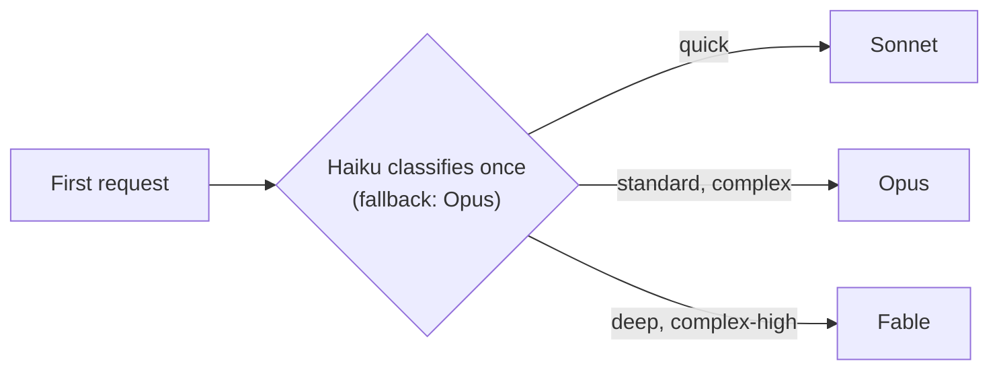
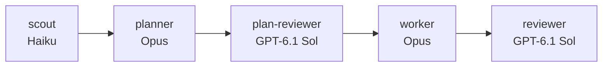

# pi-halfmoon-setup

**English** | [한국어](README.ko.md)

[](https://github.com/halfmoon-mind/pi-halfmoon-setup/actions/workflows/test.yml)
[](LICENSE)

> A personal [pi](https://pi.dev) package that picks a model from the first request and splits work across role-based agents.

Same model router, subagents, and workflow prompts on every machine. `router/auto` classifies the first user message **once** and keeps that tier for the whole session, so model switches never break the prompt cache. (Exception: a question-only `quick` session re-classifies each message until one needs more than Sonnet.)





**Contents:** [Features](#features) · [Quick start](#quick-start) · [Usage](#usage) · [Model selection](#model-selection) · [Troubleshooting](#troubleshooting) · [Development](#development)

---

## Features

| Feature | What it does |
|---|---|
| **Per-session routing** | Main session on Opus; logic-heavy (`deep`) and very hard work on Fable; thinking level to match |
| **Haiku classifier** | Claude Haiku picks the tier and thinking through your `claude` login; falls back to Opus |
| **Role-based subagents** | Explore, plan, implement, and review in isolated contexts |
| **Workflow commands** | `/implement`, `/scout-and-plan`, `/implement-and-review`, `/deep` |
| **Plan first** | Anything bigger than a quick fix gets a reviewed plan file, then builds in a new session or a worker subagent depending on how full the session is |
| **Review gate** | Another model family reviews each prompt's changes before pi stops and sends blocking issues back |
| **Prompt timing** | Live elapsed time in the footer, a summary line after each prompt, and typical bash durations ([details](#prompt-timing)) |
| **Claude CLI provider** | Uses your logged-in `claude` CLI as a pi model provider |
| **PDF & Office reading** | `read` sends text, plus images only for pages/slides that need them |
| **Sandbox** | bash runs in an OS sandbox; pi's file tools follow the same path rules |

## Quick start

**Requires:** `pi` and Claude Code's `claude` on your PATH. This repo is a package pi loads, not a standalone app.

### 1. Install

```bash
curl -fsSL https://raw.githubusercontent.com/halfmoon-mind/pi-halfmoon-setup/main/setup.sh | bash
# or, from a clone:
./setup.sh
```

On macOS, `setup.sh` installs or signs in to only what is missing, so re-running it changes nothing. On Linux it prints the steps instead, starting with `apt-get install poppler-utils pandoc ripgrep bubblewrap socat libreoffice`.

<details>
<summary>What <code>setup.sh</code> does</summary>

- Installs with Homebrew:
  - **poppler** — PDF reading
  - **pandoc** — Word files
  - **ripgrep** — bash sandbox
  - **LibreOffice** — PowerPoint slide images (without it, those slides come with their embedded pictures only)
- Installs this package: `pi install git:github.com/halfmoon-mind/pi-halfmoon-setup`
- Runs `claude auth login` and `pi auth login openai`
- Adds [the recommended settings](#recommended-settings) to `~/.pi/agent/settings.json` where those keys are not set yet

</details>

<details>
<summary>Using a local checkout</summary>

Install its dependency first, then the checkout (pi does not install dependencies for a local source). Do this before `setup.sh`, which then finds the checkout in `pi list`. After editing, run `/reload` in pi.

```bash
cd ~/projects/pi-halfmoon-setup && npm ci
pi install ~/projects/pi-halfmoon-setup
```

</details>

### 2. OpenAI access

The `reviewer`, `plan-reviewer`, and `deep-worker` agents and the review gate use the `openai` provider. A ChatGPT subscription works — `setup.sh` signs in with `pi auth login openai`, or run `/login` in pi. Or use an API key:

```bash
export OPENAI_API_KEY="<your-api-key>"
```

### 3. Run

```bash
pi --model router/auto
```

Or pick `router/auto` with `/model` while pi is running.

At startup, pi warns about anything missing (the `claude` CLI or its login, `openai` credentials, poppler, pandoc, LibreOffice), and a line above the editor lists the workflow commands until the first prompt.

### Recommended settings

Set these in `~/.pi/agent/settings.json` on each machine (`setup.sh` adds any that are missing). A running pi keeps the old values until it restarts.

| Key | Effect |
|---|---|
| `"quietStartup": "header"` | Hides pi's list of loaded skills and extensions |
| `"hideThinkingBlock": true` | Keeps thinking folded until `Ctrl+T`; the tool calls already show where the work is heading. A folded block draws nothing, not even `Thinking...`. Startup warns until this key is set; set `false` to keep thinking shown and drop the warning |
| `"steeringMode": "all"` | Delivers every queued steer together on the next turn, instead of one per turn |
| `"followUpMode": "all"` | Same for follow-ups, which still wait until the agent would stop |

A collapsed bash call shows the model-written description when there is one, otherwise its command's first line (minus a leading `cd` into the session's directory). `Ctrl+O` shows the command as written.

## Usage

Type a prompt command followed by the task:

```text
/scout-and-plan Investigate the login flow and plan better session-expiry handling
/implement Add a theme option to the config file
/implement-and-review Fix the API response parsing error and review the fix
/deep Make the token bucket rate limiter hold its limit under concurrent requests
```

| Command | Steps | Result |
|---|---|---|
| `/scout-and-plan` | scout → planner → plan-reviewer | Exploration and a reviewed plan, no implementation |
| `/implement` | scout → planner → plan-reviewer → worker | Implementation after exploration, planning, and plan review |
| `/implement-and-review` | worker → reviewer → worker | Implementation, review, and fixes for Critical issues |
| `/deep` | deep-worker (→ worker if it escalates) | One logic-heavy goal on GPT-6.1 Sol, handed to the worker when evidence cannot settle a decision |

The prompts use the `subagent` tool's `chain` mode, passing each step's output to the next with `{previous}`. The tool also supports a single agent (`agent` + `task`) and parallel runs (`tasks`).

Collapsed, a subagent run is one line per agent: its current tool call while running, the first line of its answer (or error) once done, and `waiting` for chain steps not started yet. `Ctrl+O` shows each task, its tool calls, and its full output.

### Workflow

- **Plan first and handoff** — a change bigger than a quick fix gets a reviewed plan in `docs/plans/` first; the `handoff` tool runs its build here through a `worker` subagent, or in a new session when this one is full.
- **Review gate** — before pi stops, the `reviewer` agent reviews the prompt's changes and sends blocking issues back to the model. `/review-gate off` turns it off.

See [docs/workflow.md](docs/workflow.md) for details.

### Prompt timing

The footer ticks the elapsed time while a prompt runs, and one line after it gives the total, the agent time, and the slowest tools. While a bash command runs, the footer shows how long it usually takes, and a run past twice that tells the model.

Durations live in `~/.pi/agent/bash-times.json`, which stores only a hash of the directory and command, the executable's name, and the last 10 times — no paths or arguments.

### File reading

- **PDF** — each page's text, plus an image of only the pages with figures or no text.
- **Word / Excel / PowerPoint** — text with tracked changes, comments, formulas, chart data, and speaker notes, plus an image of only the slides that need one.

See [docs/file-reading.md](docs/file-reading.md) for how pages and slides are picked and the measurements.

### Sandbox

bash runs in an OS sandbox that writes only in the project and temp dirs, reaches only allowed hosts, and cannot read the listed credential paths. pi's file tools follow the same paths, and a few risky actions ask first.

See [docs/sandbox.md](docs/sandbox.md) for the rules, the access dialog, escalation, `sandbox.json`, and what it does not cover.

## Model selection

`router/auto` classifies the first user message into a tier and sets thinking from how hard the request is:

| Tier | Model |
|---|---|
| `quick` | Sonnet |
| `standard`, `complex` | Opus |
| `deep`, `complex-high` | Fable |

When classification fails, it uses `complex` on Opus. See [docs/routing.md](docs/routing.md) for the full tier table, the classifier, and the dataset log.

### Agents

| Agent | Model | Role |
|---|---|---|
| `scout` | `pi-claude-cli/claude-haiku:high` | Reads the code and summarizes relevant files and key context |
| `planner` | `pi-claude-cli/claude-opus:high` | Writes an implementation plan from the exploration and requirements |
| `plan-reviewer` | `openai/gpt-6.1-sol:xhigh` | Fixes blockers in the plan with a different model family before the worker runs it |
| `worker` | `pi-claude-cli/claude-opus:high` | Implements the assigned task |
| `deep-worker` | `openai/gpt-6.1-sol:medium` | Delivers one logic-heavy goal that tests can settle, or replies `ESCALATE` (oh-my-openagent's deep-low lane) |
| `reviewer` | `openai/gpt-6.1-sol:high` | Reviews code quality and security with a different model family |

- Claude model names are partial names that pi resolves. Set roles and models in [`agents/`](agents/).
- The `subagent` tool lists agents with their `description`, so the main model can delegate on its own (e.g. a logic-heavy subtask to `deep-worker`). Run `/reload` after adding an agent.

**Agent scope:**

| `agentScope` | Loads | Priority on name collision |
|---|---|---|
| `"user"` (default) | Package agents + `~/.pi/agent/agents/` | User agents win |
| `"both"` | The above + project `.pi/agents/` | Project agents win |
| `"project"` | Project `.pi/agents/` only | — |

## Troubleshooting

| Symptom | What to check |
|---|---|
| Every new session warns `classifier unavailable` | `claude` is on your PATH and `claude auth login` is done |
| The `pi-claude-cli` provider fails to load | `claude` is on your PATH and `claude auth login` is done |
| `is not in the model catalog` | The chosen provider is loaded; check pi's model catalog |
| Auth errors in `deep-worker`, a review step, or the review gate | The `openai` provider's authentication and your access to the model |
| A project agent is not picked up | You pass `agentScope: "both"` or `"project"` |
| `pdfinfo not found` when reading a PDF | `brew install poppler` or `apt-get install poppler-utils` |
| `pandoc not found` when reading a .docx | `brew install pandoc` or `apt-get install pandoc` |
| A .pptx read says LibreOffice could not render the slides | `brew install --cask libreoffice`. Until then, those slides come with their embedded pictures only |

Claude requests run through `claude -p`, so Claude Code's user settings, hooks, and plugins can affect them. Its MCP servers and built-in tools are left out, except web search and fetch; pi's own tools reach Claude through an MCP server, and one `claude` process keeps the conversation between turns. Keep credentials and per-machine UI settings in each machine's pi and Claude config, not in this repository.

## Development

### Repository layout

```text
setup.sh                    Installs and signs in to what the package needs, skipping what is ready
agents/                     Role prompts and model settings
prompts/                    Workflow templates for slash commands
extensions/
  router.ts                 router/auto: classification, tiers and routing
  router.test.ts            Router tests
  sandbox/                  OS sandbox for bash, and the same path checks for pi's file tools
  footer.ts                 Two-line footer with the routed tier and model
  review-gate.ts            Stop-time review of each prompt's changes
  handoff.ts                Plan-first note, the handoff tool, and /handoff
  checks.ts                 The plan step format: parse, lint, and run a check
  pdf-read.ts               read for PDFs: page text plus images where needed
  office-read.ts            read for .docx, .xlsx and .pptx: text plus images where needed
  tab-follow-up.ts          Tab queues a follow-up while the agent runs
  timing.ts                 Live prompt timer in the footer and a timing line after each prompt
  test-hooks.ts             Loads pi's packages in tests the way pi does
  subagent/                 Subagent runs and agent discovery
  pi-claude-cli/            Claude CLI provider
docs/                       Reference: workflow, routing, file reading, sandbox
docs/images/                GitHub social preview image
bench/agent/                Agent eval set: pass and false-done rates per model
```

### Tests

Requires Node.js 22.18+ and pi installed. Run from the repository root:

```bash
npm test
```

<details>
<summary>What the tests cover</summary>

- **Router** — classification, fallback, model selection, and the Haiku call's arguments and failures
- **Subagent tool** — agent loading and chain runs
- **Review gate** — change detection, verdicts, and plan checks
- **Handoff** — session signals, the stay-or-leave decision and new session, and keeping plan files out of git
- **PDF read** — which pages get an image, and page ranges
- **Office read** — Word tracked changes, Excel cells and formulas, PowerPoint chart data, notes and pictures
- **Claude CLI provider** — system prompt handoff, tool calls, and CLI error handling

pi's packages load from the installed pi (`~/.pi/agent/install`), and fake processes stand in for `pi` and `claude`. Real provider authentication and full workflow runs need to be checked separately.

</details>

GitHub Actions runs the same tests on every push and PR, and weekly against the newest pi from npm, so a pi update that breaks this package shows up right away.

### Eval set

`PI_EVAL=1` gates print mode (`pi -p`) like an interactive session: the plan-first note, `handoff` (which then never moves the build to a new session), plan checks, and the review gate. Subagents run in json mode and are never gated.

`bench/agent/` holds eight tasks that measure pass rate and false-done rate per model, with and without the gate:

```bash
node --import ./extensions/test-hooks.ts bench/agent/run.ts --dry
```

`--dry` checks the fixtures with no model calls, but needs the installed pi since it loads pi's packages through `test-hooks.ts`. Real runs are manual and billed, and a gate run needs `/review-gate on`; see [`bench/agent/README.md`](bench/agent/README.md).

## License and attribution

[MIT](LICENSE). The `subagent` extension comes from pi's examples, modified to load this package's agents. The Claude CLI provider is `pi-claude-cli` 0.3.1, modified for pi 0.99, and includes its [MIT license](extensions/pi-claude-cli/LICENSE).
