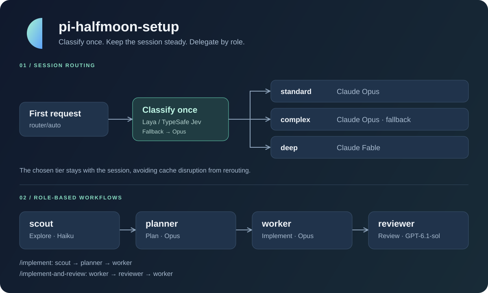

# pi-halfmoon-setup

**English** | [한국어](README.ko.md)

[](https://github.com/halfmoon-mind/pi-halfmoon-setup/actions/workflows/test.yml)
[](LICENSE)

**A personal [pi](https://pi.dev) package that picks a model from the first request and splits work across role-based agents.**

Use the same model router, subagents, and workflow prompts on every machine. `router/auto` classifies the first user message once and keeps the chosen tier for the whole session, so repeated model switches never break the prompt cache. The exception is a question-only `quick` session, which classifies each new message until one needs more than Sonnet.



## Features

- **Per-session routing** — keeps the main session on Opus, runs logic-heavy (`deep`) and very hard work on Fable, and sets thinking to match.
- **Role-based subagents** — explore, plan, implement, and review in isolated contexts.
- **Workflow commands** — chain work with `/implement`, `/scout-and-plan`, and `/implement-and-review`.
- **Plan first, build in a clean context** — a code change bigger than a quick fix gets a reviewed plan file first, and its build moves to a new session or a worker subagent depending on how full the session is.
- **Stop-time review gate** — another model family reviews each prompt's changes before pi stops, and sends blocking issues back.
- **Prompt timing** — the footer ticks the elapsed time while a prompt runs, and one line after it gives the total, the agent time, and the slowest tools.
- **Claude CLI provider** — uses your logged-in `claude` CLI as a pi model provider.
- **PDF reading** — `read` sends each PDF page's text, plus an image of only the pages with figures or no text.
- **Office file reading** — `read` sends Word, Excel and PowerPoint files as text with tracked changes, comments, formulas, chart data and speaker notes, plus an image of only the slides that need one.
- **Haiku classifier** — Claude Haiku picks each session's tier and thinking through your `claude` login, and falls back to Opus when it cannot.
- **Sandbox** — bash runs in an OS sandbox that writes only in the project and temp dirs, reaches only allowed hosts, and cannot read the listed credential paths; pi's file tools follow the same paths, and a few risky actions ask first.

## Quick start

### 1. Prerequisites and install

`pi` and Claude Code's `claude` command must be on your PATH; this repository is not a standalone app but a package that pi loads. On macOS, `setup.sh` checks the rest and installs or signs in to only what is missing, so running it again changes nothing:

```bash
curl -fsSL https://raw.githubusercontent.com/halfmoon-mind/pi-halfmoon-setup/main/setup.sh | bash
# or, from a clone:
./setup.sh
```

It installs with Homebrew poppler for reading PDFs, pandoc for Word files, ripgrep for the bash sandbox, and LibreOffice for PowerPoint slide images (without it, those slides come with their embedded pictures only); installs this package (`pi install git:github.com/halfmoon-mind/pi-halfmoon-setup`); runs `claude auth login` and `pi auth login openai`; and adds `"quietStartup": "header"`, `"hideThinkingBlock": true`, `"steeringMode": "all"` and `"followUpMode": "all"` to `~/.pi/agent/settings.json` where those keys are not set yet. On Linux it prints the steps instead, starting with `apt-get install poppler-utils pandoc ripgrep bubblewrap socat libreoffice`.

To use a local checkout instead, install its dependency and then the checkout (pi does not install dependencies for a local source). Do this before running `setup.sh`, which then finds the checkout in `pi list`. After editing, run `/reload` in pi to load the changes.

```bash
cd ~/projects/pi-halfmoon-setup && npm ci
pi install ~/projects/pi-halfmoon-setup
```

The `reviewer`, `plan-reviewer`, and `deep-worker` agents and the review gate use the `openai` provider. A ChatGPT subscription works: `setup.sh` signs in with `pi auth login openai`, or run `/login` in pi. To use an API key instead:

```bash
export OPENAI_API_KEY="<your-api-key>"
```

### 2. Run

```bash
pi --model router/auto
```

You can also pick `router/auto` with `/model` while pi is running.

At startup, pi warns about anything this package needs that the machine lacks (the `claude` CLI or its login, `openai` credentials, poppler, pandoc, LibreOffice), and a line above the editor lists the workflow commands until the first prompt. To hide pi's list of loaded skills and extensions, set `"quietStartup": "header"` in `~/.pi/agent/settings.json` on each machine. To keep thinking blocks folded until you press `Ctrl+T`, set `"hideThinkingBlock": true` there too; the tool calls already show where the work is heading. Until that key is set, startup warns about it; set it to `false` to keep thinking shown and drop the warning. A folded thinking block draws nothing, not even pi's `Thinking...` line. Collapsed, a bash call shows the model-written description when there is one, and otherwise its command's first line without a leading `cd` into the session's directory; `Ctrl+O` shows the command as written. Set `"steeringMode": "all"` and `"followUpMode": "all"` there as well, so pi delivers every queued message of a kind together when that queue is next read instead of one per turn: steers reach the next turn, and follow-ups still wait until the agent would stop; a running pi keeps the old values until it restarts.

## Usage

In pi's input box, type a prompt command followed by the task.

```text
/scout-and-plan Investigate the login flow and plan better session-expiry handling
/implement Add a theme option to the config file
/implement-and-review Fix the API response parsing error and review the fix
/deep Make the token bucket rate limiter hold its limit under concurrent requests
```

| Command | Steps | Result |
|---|---|---|
| `/scout-and-plan` | scout → planner → plan-reviewer | Code exploration and a reviewed implementation plan, with no implementation |
| `/implement` | scout → planner → plan-reviewer → worker | Implementation after exploration, planning, and plan review |
| `/implement-and-review` | worker → reviewer → worker | Implementation, review, and fixes for the review's Critical issues |
| `/deep` | deep-worker (→ worker if it escalates) | One logic-heavy goal on GPT-6.1 Sol, handed to the worker when evidence cannot settle a decision |

The prompts use the `subagent` tool's `chain` mode and pass each step's output to the next with `{previous}`. The tool itself supports a single agent (`agent` + `task`), parallel runs (`tasks`), and sequential runs (`chain`). Collapsed, a subagent run is one line per agent: the tool call it is on while it runs, the first line of its answer (or its error) once done, and `waiting` for chain steps not started yet. `Ctrl+O` shows each task, its tool calls and its full output.

### Workflow

- **Plan first and handoff** — a change bigger than a quick fix gets a reviewed plan in `docs/plans/` first, and the `handoff` tool runs its build here through a `worker` subagent, or in a new session when this one is full.
- **Review gate** — before pi stops, the `reviewer` agent reviews the prompt's changes and sends blocking issues back to the model; `/review-gate off` turns it off.
- **Timing** — the footer ticks the elapsed time while a prompt runs, and one line after it gives the total, the agent time, and the slowest tools.

See [docs/workflow.md](docs/workflow.md) for the details.

## Model selection

`router/auto` classifies the first user message into a tier (`quick`, `standard`, `complex`, `deep`, or `complex-high`), runs the session on Sonnet, Opus, or Fable to match, and sets thinking from how hard the request is. When classification fails, it uses `complex` on Opus. See [docs/routing.md](docs/routing.md) for the tier table, the classifier, and the dataset log.

### Agents

| Agent | Model setting | Role |
|---|---|---|
| `scout` | `pi-claude-cli/claude-haiku:high` | Reads the code and summarizes the relevant files and key context |
| `planner` | `pi-claude-cli/claude-opus:high` | Writes an implementation plan from the exploration and the requirements |
| `plan-reviewer` | `openai/gpt-6.1-sol:xhigh` | Fixes blockers in the plan with a different model family before the worker runs it |
| `worker` | `pi-claude-cli/claude-opus:high` | Implements the assigned task |
| `deep-worker` | `openai/gpt-6.1-sol:medium` | Delivers one logic-heavy goal that tests can settle, or replies `ESCALATE` (oh-my-openagent's deep-low lane) |
| `reviewer` | `openai/gpt-6.1-sol:high` | Reviews code quality and security with a different model family |

The agents' Claude model names are partial names that pi resolves. Set roles and models in the Markdown files in [`agents/`](agents/). The `subagent` tool lists the agents with their `description`, so the main model can delegate on its own, for example a logic-heavy subtask to `deep-worker`; run `/reload` after adding an agent.

The default `agentScope: "user"` loads the package's agents and `~/.pi/agent/agents/`; when names collide, your user agents win. To also use the project's `.pi/agents/`, pass `agentScope: "both"` in the tool call, and project agents take the highest priority. `agentScope: "project"` loads only project agents.

## File reading

`read` sends a PDF as each page's text, plus an image of only the pages with figures or no text, and Word, Excel and PowerPoint files as text with tracked changes, comments, formulas, chart data and speaker notes, plus an image of only the slides that need one. See [docs/file-reading.md](docs/file-reading.md) for how pages and slides are picked and the measurements.

## Sandbox

bash runs in an OS sandbox that writes only in the project and temp dirs, reaches only allowed hosts, and cannot read the listed credential paths; pi's file tools follow the same paths, and a few risky actions ask first. See [docs/sandbox.md](docs/sandbox.md) for the rules, the access dialog, escalation, `sandbox.json`, and what it does not cover.

## Troubleshooting

| Symptom | What to check |
|---|---|
| Every new session warns `classifier unavailable` | Check that `claude` is on your PATH and `claude auth login` is done |
| The `pi-claude-cli` provider fails to load | Check that `claude` is on your PATH and that `claude auth login` is done |
| `is not in the model catalog` | Check that the chosen provider is loaded and check pi's model catalog |
| Auth errors in `deep-worker`, a review step, or the review gate | Check the `openai` provider's authentication and your access to the model |
| A project agent is not picked up | Check that you pass `agentScope: "both"` or `"project"` |
| `pdfinfo not found` when reading a PDF | Install poppler: `brew install poppler`, or `apt-get install poppler-utils` |
| `pandoc not found` when reading a .docx | Install pandoc: `brew install pandoc`, or `apt-get install pandoc` |
| A .pptx read says LibreOffice could not render the slides | Install LibreOffice: `brew install --cask libreoffice`. Until then, those slides come with their embedded pictures only |

Claude requests run through `claude -p`, so Claude Code's user settings, hooks, and plugins can affect them. Its MCP servers and its built-in tools are left out, except web search and fetch; pi's own tools reach Claude through an MCP server, and one `claude` process keeps the conversation between turns. Keep credentials and per-machine UI settings in each machine's pi and Claude config, not in this repository.

## Repository layout

```text
setup.sh                    Installs and signs in to what the package needs, skipping what is ready
agents/                     Role prompts and model settings
prompts/                    Workflow templates for slash commands
extensions/
  router.ts                 router/auto: classification, tiers and routing
  router.test.ts            Router tests
  sandbox/                  OS sandbox for bash, and the same path checks for pi's file tools
  footer.ts                 Two-line footer with the routed tier and model
  review-gate.ts            Stop-time review of each prompt's changes
  handoff.ts                Plan-first note, the handoff tool, and /handoff
  checks.ts                 The plan step format: parse, lint, and run a check
  pdf-read.ts               read for PDFs: page text plus images where needed
  office-read.ts            read for .docx, .xlsx and .pptx: text plus images where needed
  tab-follow-up.ts          Tab queues a follow-up while the agent runs
  timing.ts                 Live prompt timer in the footer and a timing line after each prompt
  test-hooks.ts             Loads pi's packages in tests the way pi does
  subagent/                 Subagent runs and agent discovery
  pi-claude-cli/            Claude CLI provider
docs/                       Reference: workflow, routing, file reading, sandbox
docs/images/                README diagram and GitHub social preview image
bench/agent/                Agent eval set: pass and false-done rates per model
```

## Tests

Run from the repository root with Node.js 22.18 or later and pi installed.

```bash
npm test
```

The tests cover the router's classification, fallback, model selection, and the Haiku call's arguments and failures; the subagent tool's agent loading and chain runs; the review gate's change detection, verdicts, and plan checks; the handoff's session signals, its stay-or-leave decision and new session, and keeping plan files out of git; which PDF pages `read` sends with an image, and its page ranges; how it sends Word tracked changes, Excel cells and formulas, and PowerPoint chart data, notes and pictures; and the Claude CLI provider's system prompt handoff, tool calls, and CLI error handling. pi's packages load from the installed pi (`~/.pi/agent/install`), and fake processes stand in for `pi` and `claude`. Real provider authentication and full workflow runs need to be checked separately.

GitHub Actions runs the same tests on every push and PR, and weekly against the newest pi from npm, so a pi update that breaks this package shows up right away.

### Eval set

`PI_EVAL=1` gates print mode (`pi -p`) like an interactive session: the plan-first note, `handoff` (which then never moves the build to a new session), plan checks and the review gate. Subagents run in json mode and are never gated. `bench/agent/` holds eight tasks that measure pass rate and false-done rate per model, with the gate and without:

```bash
node --import ./extensions/test-hooks.ts bench/agent/run.ts --dry
```

`--dry` checks the fixtures with no model calls, but it needs the installed pi, since it loads pi's packages through `test-hooks.ts`. Real runs are manual and billed, and a gate run needs `/review-gate on`; see `bench/agent/README.md`.

## License and attribution

[MIT](LICENSE). The `subagent` extension comes from pi's examples and is modified to load the agents in this package. The Claude CLI provider is `pi-claude-cli` 0.3.1, modified for pi 0.99, and includes its [MIT license](extensions/pi-claude-cli/LICENSE).
